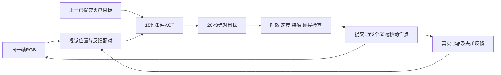

# NERO ACT仿真迁移真机问题复盘与实施记录

更新日期：2026年10月21日。目标是让ACT利用运动中的相机观测，完成空黄色杯的抓取、抬升、搬运、放到蓝卡、松爪和退出，并适应限定区域内的杯位变化。

最新接近动作保持已实现并完成1000步离线试验：413项回归通过/5跳过，423帧训练前逐帧误差为0；但保持与完整任务失败。七轴均方根漂移由上一轮0.247升至0.961毫弧度，当前2933点非预期接触停止、未GRASP；局部机制4/6。夹爪最大漂移由0.553降至0.020毫米，不能据此宣布接近改善。详见[完整报告与轨迹图](../nero_act_approach_preservation_20261021/evidence/results.md)、[最终核验](../nero_act_approach_preservation_20261021/evidence/final_verification.json)。当前建议减小输出层更新幅度并增加衰减，尚未实施；本轮未扩预算或启动真机。

## 此前15维训练结果（历史记录）

本轮修复结论：两次各20轮训练和三次原场景对照后，完整抓放仍未通过。第一次全网重训在732点、闭爪前意外接触；第二次仅夹爪微调建立稳定夹持，在1777点被旧持杯模型桌面保护拒绝；第三次修正保护器位姿/离桌锁存后，在1792点因ACT削弱夹持而停止，尚未抬升。组件回归292通过、5跳过，不等于任务通过。详见[三次修复完整复盘](../nero_act_visual_attachment_fix_20261019/evidence/repair_retrospective.md)。原5/16结果不覆盖，新独立16项尚未使用，本轮未下发真机动作。用户已选择短历史ACT与闭环恢复示教对照，[具体结构设计](superpowers/specs/2026-10-19-nero-act-short-history-design.md)已书面批准，[十二项实施计划](superpowers/plans/2026-10-19-nero-act-short-history.md)已批准并开始顺序实施；历史接口、完整快照、ACT调用链与共同运行器已通过验证，当前正在生成恢复数据，尚未开始新训练。采样数增加改变优化步数和验证损失构成，不能作等步数单因素归因或直接比较不同采样下的损失。

| 项目 | 实际结果 | 含义 |
| --- | --- | --- |
| 正式训练 | 320×180和160×90均20/20轮，完整性通过 | 训练完成，不能据此认定任务成功 |
| 最佳零潜变量验证损失 | 320×180为0.007631，第17轮；160×90为0.007892，第18轮 | 前者作为本轮16场景评估的预选候选，不用最终测试重新挑模型 |
| 320×180完整开发测试 | 0/1；仅到GRASP，3900个有效动作点用尽，杯底最大抬升约0.002毫米 | 没有完成抬升、搬运、放置和退出 |
| 160×90完整开发测试 | 0/1；仅到GRASP，3900点用尽，杯底最大抬升约0.345毫米 | 换分辨率未解决完整流程停滞 |
| 16场景评估 | **5/16完整通过**，16项全部结束并核验冻结依赖 | 9杯位3项通过、4起点2项通过、最后3项均失败，限定名义仿真域 |
| 真机软件 | 同帧15维推理、短前缀下发与ROS结果监督组件已实现 | 实际部署链路尚未组装验收；入口仍拒绝执行 |
| 本轮真机运动 | 未发送机械臂、夹爪或使能命令 | 本轮结果均不构成真机抓放成功 |
| 第一次采样修复重训 | 20轮完成，原场景0/1，732点意外接触 | 全网适配造成接近退化，不能认定已修复 |
| 第二次已有夹爪分支微调 | 20轮完成，208非夹爪张量及统计保持；原场景0/1 | 已建立稳定夹持，后续被持杯保护停止 |
| 第三次仿真保护器修正 | 同一冻结权重，原场景0/1，1792点 | 持杯参考位姿/离桌锁存缺陷修正；ACT仍预测削弱夹持，未完成抬升 |

训练证据：[完成核验](../nero_act_visual_feedback_20261019/evidence/formal_training_completion_verified.json)。完整开发结果：[320×180](../nero_act_visual_validation_20261019/results/nominal_320/summary.json)、[160×90](../nero_act_visual_validation_20261019/results/nominal_160/summary.json)。后续对照使用冻结模型，保留失败记录。

本轮16项中，7项耗尽点预算、2项意外接触、1项持杯模型桌面保护、1项延迟观测时效保护停止。成功例`heldout_xy_0`抬升192.28毫米、搬运161.05毫米，释放并退出后稳定101帧。可观看[完整成功仿真视频](../nero_act_visual_validation_20261019/evidence/ACT_visual15_full_success_simulation_2x.mp4)：按记录查询状态以2倍速显示，记录间隔保持画面，不重新生成控制。实际表现仍不足以进入真机。

## 迁移路线与组件职责

最初确认MuJoCo、MoveIt和RViz环境，随后进行了微幅连通性测试、高位空中动作和完整幅度空载演示。再进入接触杯子的抓放测试，使用模型TCP、低速和阶段确认。用户之后明确要求任务动作必须来自ACT，因而区分了在线ACT和ACT仿真轨迹回放，最终选择运动中实时视觉反馈的15维ACT路线。

| 路线 | 任务动作由谁产生 | 杯位变化时的行为 | 能证明什么 |
| --- | --- | --- | --- |
| 早期视觉定位加MoveIt抓放 | 几何定位与规划器 | 重新定位、规划 | 可检查几何与通信，不是ACT迁移证明 |
| ACT仿真轨迹真机回放 | 先在仿真由ACT生成，再保护回放 | 固定轨迹不会自主追随新杯位 | 验证动作链路和固定场景可行性 |
| 原8/9维在线ACT | 当前RGB和状态预测20×8目标 | 可随观测变化，但实际泛化要测试 | 发生过真实大幅接近，接触阶段仍有失败 |
| 新15维在线ACT | RGB、8维状态、因果历史、6维实时相对位置 | 每个短前缀后重新观测与预测 | 当前目标路线，尚未完整闭环验收 |

MoveIt在目标路线中负责整臂、夹爪及持杯碰撞有效性检查；不接管ACT的抓放动作。RViz用于查看机器人和场景。相机负责观测，不直接生成固定闭爪或搬运指令。

短前缀限制每次开环时间，不缩小整段任务幅度；正常过程不逐个小角度请求确认，保留GRASP、离桌后NEXT、承托后RELEASE、退出前NEXT四次关键确认。

## 环境 状态与场景问题

| 编号 | 问题与表现 | 原因或证据 | 修正办法与状态 |
| --- | --- | --- | --- |
| 1 | 需要确认是否有MuJoCo、MoveIt、RViz及最新工程 | 后续已有实际MuJoCo物理记录、ROS检查及MoveIt/RViz配置；本轮Python3.12.3、Torch2.5.1+cu121、MuJoCo3.15.0 | 以工程入口、实际进程和日志核对环境，IDE打开文件不代表该程序正在运行；本轮未重新启动真机ROS栈 |
| 2 | 最新文件已放入目录，但可能仍引用旧配置 | 多个日期目录并存，权重、统计、起点和schema来自不同版本时不能混用 | 为权重、统计、源码、场景和数据建立哈希；封存旧包，新改动放隔离目录 |
| 3 | J2、J7反馈相差几十度，用户没有移动机械臂 | 真实ROS反馈与独立SDK一致，GenericSystem虚拟控制桥残留旧轨迹位置 | 核对反馈来源，在发送封锁下只同步虚拟桥；不能用虚拟控制器状态当实体起点 |
| 4 | “没有移动”实际指完成后没有继续动 | 用户后续确认是收到完成消息后保持，而非整个执行期间静止 | 把执行时间、实际关节范围和完成后保持分别记录；完成不自动追加动作 |
| 5 | “已恢复”只恢复杯位或夹爪，机械臂仍在杯旁 | SDK和ROS一致，尚未回高位 | 分别核对七轴起点、实际开度、杯位和蓝卡；后续把高位张爪纳入受控准备方案 |
| 6 | 反复微小移动，未展示完整流程 | 早期是连通性和安全小测试，任务范围尚未落实为整段 | 后续明确采用完整幅度空载、完整抓放或完整ACT；不能把小幅测试算整段验收 |
| 7 | 空载演示与实际夹杯目标混淆 | 用户先接受未抓起杯子，后来明确本轮必须夹杯搬运放置 | 分开记录空载链路通过与真实持物任务结果，后者包含离桌、承托释放及退出 |
| 8 | 杯子声称移走，照片仍显示存在 | 现场口头确认和当前画面不一致 | 执行前复拍核对；不能在目标占据下降路径时按空载方案执行 |
| 9 | 不能调整现场，仍反复要求移杯、张爪 | 人员暂时无法操作，部分“已调整”未对应可见变化 | 保留授权与终态，停止反复要求相同操作；离线工作继续，运动前重新核对真实起点 |

反馈来源与虚拟桥证据见[原迁移过程第4节](../nero_act_sim_to_real_full_process_20261018.md#41-先确认读到的是真实机械臂)及[反馈复核](../nero_act_full_pick_place_20261017/evidence/feedback_source_recheck.json)。

## 标定 定位与下降接触问题

| 编号 | 问题与表现 | 原因或证据 | 修正办法与状态 |
| --- | --- | --- | --- |
| 10 | 历史桌高0、−10、−13毫米混用 | 来源与绝对base原点假设不同，缺独立统一验收 | 保留来源，不取平均；新标定包要求原始样本、坐标系、单位和独立验证 |
| 11 | 旧135毫米TCP被碰撞检查拒绝 | 该TCP明确approximate=true，不是实测夹持中心 | 经用户接受改用link7名义TCP `[152,0,−23.5]`毫米；仍未升级为实测 |
| 12 | 模型间FK一致，实际下降仍碰杯 | 两套模型数值一致只证明实现一致；实体TCP、杯口、杯把和指面仍可能有误差 | 独立测TCP与指面、杯身/杯口/杯把及桌面，按误差预算检查真实扫掠外形；尚未实测完成 |
| 13 | 用户指出下降时距离杯子过近 | 现场确认夹指接触或杯子被推动；旧圆柱模型仍显示名义空隙 | 保留接触失败，停止原轨迹重试；不能凭该现象确定唯一TCP补偿量 |
| 14 | 相机拟合通过但定位有毫米至厘米偏差 | 10月14日拟合平移RMSE6.632毫米、最大残差10.885毫米，不是独立工作区误差界 | 实现外参求解与独立3D验证；不能用重投影残差或样本内拟合代替现场精度 |
| 15 | 倒装、缩放和内参约定容易混用 | ZED图像旋转180°；定位640×360与策略160×90/320×180不同 | 统一rectified图、分辨率K和一次旋转，K纳入相机元数据哈希；新实际曝光映射待验收 |
| 16 | 蓝卡唯一性检测被手机、屏幕蓝色干扰 | 现场手机/显示器产生额外蓝色区域 | 移开手机或朝下，收起干扰窗口；使用唯一目标检测，出现多个候选时拒绝，不猜目标 |
| 17 | 杯子偏移几毫米就反复要求对齐 | 固定回放源位有锁定范围，轨迹本身不会根据新杯位调整；现有模型泛化也未通过 | 保留回放范围限制，改做实时位置条件ACT；不把放宽回放容差当作泛化修复 |
| 18 | 用户手动调整杯子，程序看到约19毫米变化 | 后续用户明确是手动移动；其他轮次也确认过夹指推动 | 区分手动变化和意外接触，执行/确认期间不移动物体；发现变化停机，重新建立起点 |
| 19 | 单相机在夹持时遮挡，旧框不足以判断杯口和杯把 | 框只能给局部外观范围，不能自动认证夹指关系与可见性 | 新真实前端要求语义关键点、质量与误差，完全遮挡返回无效；目前尚未资格验证 |
| 20 | 希望相机在运动中实时纠偏 | 原固定轨迹/较长动作块不足以实现目标 | 同一帧RGB、同时间反馈和当前相对位置进入ACT，每次只提交1～2点；真实前端和时钟仍需接通验证 |

本轮沿用旧标定是用户对离线正式训练的明确要求，不包含将其改写为已实测或允许真实接近。参数与来源见[训练标定版本](../nero_act_visual_feedback_20261019/config/retained_nominal_training_calibration.json)、[来源哈希](../nero_act_visual_feedback_20261019/evidence/retained_calibration_sources.json)。

## ACT训练与完整任务失败问题

| 编号 | 问题与表现 | 原因或证据 | 修正办法与状态 |
| --- | --- | --- | --- |
| 21 | 仿真只到抓杯，没有抬起放置 | 只显示接近/GRASP不满足完整任务标准；完整监测还需抬升、搬运、承托释放和5秒稳定 | 使用真实物理接触与完整OutcomeMonitor，不以接触或动画进度算成功 |
| 22 | run14位置泛化仅4/16，run15独立测试0/16 | 监督误差低不保证闭环状态分布稳定 | 保存失败快照和正确教师恢复，来源分组隔离；旧测试用于修正后标为开发集 |
| 23 | 抓稳后头几个目标先向下，持杯模型穿桌 | run14复现约0.31～0.41毫米反向动作 | 增加立即抬升恢复、姿态损失和持物桌面保护；恢复数据不是完整示教成功 |
| 24 | 低位姿态/朝向误差，继续下降发生接触 | run19/run20原场景仍失败，某验证场景可完整成功 | 加入实际低位恢复并检查闭环；未因一例成功认定原场景修复 |
| 25 | 历史prior-only训练未训练CVAE后验，KL=0 | 后验参数未更新；这不是已证实的唯一失败原因 | 用户批准恢复CVAE训练，正KL；验证及部署零潜变量，禁止未来标签泄漏 |
| 26 | 实际失败输入夹爪全开且梯度为0 | 限幅前预测超过95毫米，限幅使闭爪监督梯度消失 | 增加训练用限幅前零潜变量夹爪辅助损失；推理边界和物理保护保持 |
| 27 | 全网修正夹爪后接近路径退化 | run22改善闭爪数值，但未到抓取区；仅改输出行仍不够 | 先隔离夹爪输出行，再按用户批准引入ACT内部非线性夹爪残差头；分别验证机制与任务 |
| 28 | 新夹爪头能拟合静态窗口，完整任务仍失败 | run24/run25原场景仍0/1，关键失败输入占比过低 | 平衡闭爪/释放，再聚焦实际抓取恢复；run26原开发场景最终完整通过，但不代表区域或真机通过 |
| 29 | run26固定场景通过但整体11/14；run27为9/14 | 延迟、退出或部分接近工况失败，输出层微调有接近退化 | 保留所有结果，禁止把固定成功替代完整验收；用户曾另行批准固定场景受控试验 |
| 30 | 真机在线ACT到杯旁不闭爪 | 历史真实输入预测仍接近92.74～95毫米；本轮新仿真则是目标差不足 | 分开记录两种失败，不手写闭爪替代ACT；当前仍需修正闭爪过渡与稳定夹持状态学习 |
| 31 | 仿真策略声称能泛化，实际小偏差就失败 | 训练覆盖、真实外观、坐标误差、闭环状态和固定回放是不同问题 | 输入从8/9维扩为显式15维，加入实时杯底/蓝卡相对TCP位置；泛化仍须完整闭环验证 |
| 32 | 旧实机记录不能直接作正确动作标签 | 旧七轴动作等于同帧实测关节，零超前；失败动作也不是正确标签 | 记录实际提交目标及时间，拒绝过去命令作为未来监督，保持RGB/反馈/动作配对 |
| 33 | 新15维与旧项目已有15维同名但语义不同 | 旧绝对任务坐标profile与本轮相对位置编码不同 | 新schema显式区分；新增6维只用训练组归一化，物理读出仍仅8维 |
| 34 | 新增输入后可能破坏初始化或无梯度 | 9→15投影维数与CVAE后验均需扩展 | 两个状态投影补6列零权重并仿射重配统计；初始化等价及后验/几何/layer4梯度已验证 |
| 35 | 旧训练只解冻末层，无法学习新位置输入 | 新增几何投影若冻结，将一直无效 | 本轮训练ACT/CVAE、投影、输出和夹爪头，ResNet仅layer4解冻；检查实际优化梯度 |
| 36 | 从仿真真值直接填位置会掩盖真实感知问题 | 无噪真值与真实观测分布不同 | 本轮16104个输入先渲染RGB再估计位置；物体真值仅误差诊断，不进入策略 |
| 37 | 杯子遮住蓝卡后蓝色质心偏移 | 初始离线估计器以可见蓝色中心为目标，遮挡造成偏差 | 在本轮名义轴对齐蓝卡平面使用外沿范围中心；已测回归，不是实际任意蓝卡/遮挡资格 |
| 38 | 新正式训练完成，完整流程仍停在夹持处 | 320模型末段实际开度约74.6毫米，前2点目标约72.75～73.25毫米；差值1.34～1.83毫米低于3毫米门槛 | 保留接触判据、1N限制、3900点预算，明确任务失败；修正采样/恢复监督后需重新冻结评估 |
| 39 | 当前监督对稳定闭爪差值覆盖不足 | 36训练组中4356个close帧，2232帧差值≥3毫米；实际采样893个close帧，仅30帧达到该差值 | 历史静止close过滤器压低此类占比，约51.2%降至3.4%；是有证据的监督缺口，因果修复仍待受控训练验证 |
| 55 | 简单补回全部close等待帧也可能学会一直保持 | 独立复核发现同一示教两个几乎相同观测，其未来20点却分别为保持和抬升；动作差可达0.025913rad，教师等待时长未进入策略输入 | 保留夹爪目标变化的力建立过程，将长期静止等待合并为转入抬升的末端代表。训练组保留540个≥3毫米输入；不添加运行时阶段或计时真值，不改标签。后续建立稳定夹持，但未完成任务 |
| 57 | 补齐力建立监督并重训全网后，接近路径反而退化 | 第一次修复20轮后原场景0/1：夹爪95毫米，无GRASP；732点意外接触，TCP横向偏差15.6毫米，同高度旧模型约10.1毫米 | 第一次权重与结果封存；第二次从原15维模型开始，仅微调现有夹爪分支。208个非夹爪张量逐轮保持，统计字节相同；已建立稳定夹持，后续抬升/放置仍未通过 |
| 58 | 能建立稳定夹持，但在线第一个目标随后削弱夹持 | 第三次原场景实测开度74.3156毫米、上一目标71.2867毫米，新首点71.6752毫米；向张开增加0.3886毫米，差值降至2.6403毫米 | 阶段保护拒绝该预测，未实际松爪，任务0/1。需检查短前缀连续性、闭环恢复覆盖与观测历史；短历史架构尚未开始，效果未证明 |

历史run19～27的详细参数、局部成功与失败见[完整过程记录](../nero_act_sim_to_real_full_process_20261018.md)。本轮停滞证据见[失败诊断](../nero_act_visual_validation_20261019/evidence/nominal_failure_diagnosis.json)和[接触采样审计](../nero_act_visual_validation_20261019/evidence/contact_sampling_audit.json)。未将训练完成、梯度有效、静态拟合或教师恢复成功写为ACT完整任务成功。

## 控制 通信与验收问题

| 编号 | 问题与表现 | 原因或证据 | 修正办法与状态 |
| --- | --- | --- | --- |
| 40 | 旧ACT接口100点与新20点混用，或把绝对量当增量 | 状态/动作schema、统计和执行窗口不一致 | 保持七轴rad、两指总宽度m，输出20×8绝对目标；反归一化后不再次累加 |
| 41 | 真实大幅接近中ACK超时 | 旧一次实验第59块超过45毫秒；后续并非每次重现 | 记录每端发送/确认时刻，保留45毫秒期限和停止锁存，不宣称旧根因已完全消失 |
| 42 | 冷启动就触发健康超时 | Torch/YOLO/相机初始化阻塞了已开始的监督 | 冷启动和预热前置，服务及反馈就绪后再进入150毫秒监督；未延长期限 |
| 43 | SDK读取阻塞，门健康接收过期 | 约141毫秒读取与ROS回调共线程，接收饥饿 | 独立接收节点/线程，最新值队列，检查发布与接收单调时间；隔离只读阻塞试验通过 |
| 44 | 反馈保存或重日志影响健康间隔 | 新鲜度依赖运行时处理，不只是发布频率 | 采用紧凑健康记录；后续一次约56秒现场记录最大间隔16.616毫秒，但该次仍因接触/宽度停止 |
| 45 | 开度100.06毫米越界，下降阶段已经碰杯 | 命令约95毫米，驱动单位路径未发现放大；现场确认接触/推动 | 保留0～100毫米反馈边界并停止，不能只放宽0.06毫米而忽略真实接触 |
| 46 | 确认等待后复用旧图、旧动作块 | 人工等待使预测失效，帧号增加也未必代表提交后的曝光 | 确认后丢弃旧块，要求新曝光/反馈晚于确认和上次提交；本轮输入内容和时间均绑定 |
| 47 | 执行2点却把第10点记为历史 | 会污染因果夹爪上下文并破坏下一次连续性 | 只有ACK接受的实际末点更新历史、点预算；未提交预测不计执行 |
| 48 | 已完成的控制器future绕过截止和健康检查 | 原组件只在等待循环内检查 | 独立审查后补齐进入、等待及成功返回前检查，预完成/超时用例先失败后通过 |
| 49 | 仅修改“观测年龄”却声称测试相机延迟 | 原评估仍渲染当前图像、仅改变伺服延迟 | 本轮审查后改为旧物理快照图像、配对旧反馈与当时历史；确认后清空，拒绝提交前旧曝光 |
| 50 | 多进程病例使用了不同物理网格仍可汇总 | 套件父进程此前未绑定全部XML、网格和统计 | 统一完整依赖清单，要求子病例清单与父冻结一致，汇总前重验 |
| 51 | 仅到GRASP被算作完整流程 | 局部接触与完整任务终态不同 | 要求≥180毫米抬升、>100毫米搬运、承托释放、退出、5秒稳定，四事件齐全且零意外接触/合同失败 |
| 52 | 训练提前结束却出现“成功”摘要 | 旧正式入口先写摘要再作完整性校验 | 改为全部声明轮次及输入/输出哈希通过后再写完成；提前退出不得导出 |
| 53 | 训练进程启动信息存在但未持续运行 | 受限命名空间内脱离父进程会退出；GPU在受限环境不可见 | 核实宿主机PID、GPU、实际优化步与检查点；数据准备改用宿主机EGL，不把启动命令算训练完成 |
| 54 | 部分最终测试工况只有ID，没有完整数值 | 优化前冻结了16个ID，但后3项未完整声明扰动参数 | 本轮补定义并显式标为训练后补参数；即使名义仿真全过，也不能冒充严格预声明的真实部署资格 |
| 56 | 修复分支的旧16项开发回归一度引用新协议哈希 | 分支允许选择归档协议，但构造来源时仍使用默认新文件 | 优化前修正为哈希实际选中的协议路径；新旧路径回归先失败后通过。新16项的场景、起点、光照、相机偏差及曝光延迟数值已在训练前完整冻结 |
| 59 | 持杯保护拒绝微小上行动作 | 旧模型以初始源位和过早刚性假设建立附着；杯子已偏移约8.48毫米，当前模型杯底−43.6微米，实际当前几何约−7.84微米。最初“向下”解释经复核更正：TCP预测向上约31微米 | 仿真安全几何在桌面承托期间使用当前配对位姿，首次离桌后永久冻结；−1微米阈值不变。模拟器位姿只作安全门控，不输入策略；不构成真实几何验收 |
| 60 | 查询间短暂离桌、落桌可能导致错误重新绑定 | 独立审查发现仅在ACT查询时更新，执行前缀及人工等待的反馈未锁存离桌 | 更新到每个物理子步和反馈点；完整rollout回归先失败后通过，离桌后落桌也不重新绑定。全部组件292通过、5跳过，完整任务仍失败 |

本轮独立审查及修正见[审查报告](../nero_act_visual_validation_20261019/evidence/independent_review.md)和[审查回归](../nero_act_visual_validation_20261019/evidence/review_green.log)。单元测试证明组件行为，不代替真实CAN、夹持或相机精度验证。

## 本轮真机软件实现进度

| 文件 | 已完成内容 | 仍需完成 |
| --- | --- | --- |
| [visual_inference.py](../nero_act_visual_validation_20261019/executor/visual_inference.py) | 同帧RGB/几何/配对状态/上一提交目标形成15维输入；校准版本绑定；原始预测、图像内容及曝光时刻绑定 | 合格实时相机采集器、语义前端及实际FK几何提供者 |
| [visual_control.py](../nero_act_visual_validation_20261019/executor/visual_control.py) | 1～2点前缀、ACK后历史更新、时效、3900点与停止锁存 | 与整段真实阶段监督集成 |
| [visual_dispatch.py](../nero_act_visual_validation_20261019/executor/visual_dispatch.py) | 推理等待时独立检查健康；碰撞后重验新鲜度；两个控制器完成检查；停止、取消、只读恢复回调 | 真实单发送者进程、一次性授权消费、完整阶段runner、只读恢复实测 |
| [visual_run.py](../nero_act_visual_validation_20261019/executor/visual_run.py) | 当前仍提供离线报告并拒绝执行 | 通过前置验收后再组装真正在线入口 |

本轮没有组装并使能实际运动入口，也没有用训练用名义圆柱观察器绕过真实语义前端。原5%速度、夹爪≤1N、150毫秒健康监督、45毫秒ACK、250/750毫秒时效、碰撞/持杯/滑移保护继续保留。

## 后续修正与真机顺序

用户已确认采用短历史ACT对照。新增[书面结构设计](superpowers/specs/2026-10-19-nero-act-short-history-design.md)规定：当前RGB＋5次有效15维观测，与相同恢复数据下的单帧模型比较；先各1000次更新的机制小对照，通过条件满足再安排正式训练。该设计已获书面批准；[实施计划](superpowers/plans/2026-10-19-nero-act-short-history.md)已批准，由当前会话顺序实施。18条恢复和66条五帧数据已核验，4处时序/缓存/门槛问题已修正。A/B各1000更新已完成，六项机制均2/6，按批准规则停止扩预算；未进行20轮、完整开发或新独立16项。实际进度与结果见[短历史工程](../nero_act_history_feedback_20261019/README.md)。已有其他场景成功不能被忽略，当前证据也未证明必须改变架构；应通过明确对照检验该假设。以下仍是整体迁移所需顺序，不表示已完成新结构训练。

1. 本轮冻结16场景报告已完成，5/16通过，全部失败保留。优先修复已复现的闭爪停滞，不能因为训练损失低而直接真机复试。
2. 从实际闭环停滞快照生成经过物理验收的闭爪、稳定夹持、抬升及释放恢复。检查静止close过滤、短前缀1～2点监督和因果历史；完整示教与局部恢复分开登记。已有接触监督缺口是待验证修正方向，不保证单一改动即可成功。
3. 重新训练时只以开发/验证组选模型；本轮测试已用于诊断的工况转作开发回归，新的完整数值独立测试应在优化前声明。
4. 取得TCP、桌面、指面、杯口/杯把和相机的独立样本，验证真实误差和停止距离余量。旧标定可作起始参数，不能自动升级精度资格。
5. 接通真实相机曝光时钟、合格语义观测和实际FK；使用同一输入schema做无发送shadow，测完整端到端新鲜度和遮挡失效。
6. 通过完整闭环、真实只读和隔离通信/取消/门控/恢复检查后，核对当前现场并执行一次完整抓放，保留四次关键确认。异常停止，不自动重试或回位。

## 工程与证据入口

- [原完整迁移过程和历史实验](../nero_act_sim_to_real_full_process_20261018.md)
- [已批准的实时视觉方案](superpowers/specs/2026-10-19-nero-act-live-visual-feedback-design.md)
- [已批准的顺序实施计划](superpowers/plans/2026-10-19-nero-act-live-visual-feedback.md)
- [15维正式训练说明](../nero_act_visual_feedback_20261019/README.md)
- [训练完成与完整性核验](../nero_act_visual_feedback_20261019/evidence/formal_training_completion_verified.json)
- [本轮验证及真机组件说明](../nero_act_visual_validation_20261019/README.md)
- [完整16场景汇总](../nero_act_visual_validation_20261019/results/frozen_320_suite16/summary.json)
- [闭爪停滞与采样审计](../nero_act_visual_validation_20261019/evidence/contact_sampling_audit.json)
- [本轮完整测试日志](../nero_act_visual_validation_20261019/evidence/full_suite_final.log)

历史现场授权、截图和手工确认均归属于当时尝试；最终状态以对应日志为准。当前文档和离线测试不生成新的硬件授权，也不把人工规划成功、仿真成功或只读推理成功记作ACT真机完整任务成功。

## 2026-10-20 短历史ACT实测对照

本轮为离线物理仿真检查，未连接真机。单帧A和五帧B各实际1000次更新、相同批次计划；六项机制均2/6。原失败场景预闭爪400点未抬升，稳定夹持续接在A第4点/B第6点预测张爪并被拦截；验证源可抬升20毫米和完成释放后退出，但预闭爪剩余流程耗尽总预算，落桌释放保持仍越过3毫米边界。局部通过不算完整任务成功，历史收益尚未证明。

独立审查发现并修正了执行中曝光误收、推理中图像缓存绑定、直接开发汇总不兼容、开发入口越过门槛四类问题。373项通过/5项跳过；源码/数据封存、原来源和两组训练完整性均通过最终核验。原失败输入的首1/2点夹持命令仍弱于教师，说明当前策略未稳健学会接触过渡；尚不能唯一归因为历史或CVAE。

按照已批准的`stop`条件，本轮未做20轮正式训练、完整开发、新16项独立评估或真机。下一轮应先针对失败状态验证闭爪/保持监督和输出误差，不能仅凭低损失扩大预算或放宽保护。详细数据、全部结果和复现命令见[短历史实验总结](../nero_act_history_feedback_20261019/evidence/pilot_results.md)、[最终核验](../nero_act_history_feedback_20261019/evidence/final_verification.json)和[执行账本](../nero_act_history_feedback_20261019/evidence/progress.md)。

## 2026-10-20短历史失败复检与修正

| 问题 | 本轮确认与修正 | 当前结果 |
| --- | --- | --- |
| 非线性读出前后的夹爪目标被混用 | 原限幅前辅助损失直接拟合限幅后物理目标，改为同一反馈读出的逆像监督 | 数值往返及梯度回归通过，运行边界不变 |
| 教师中断恢复遗漏承托保持参考交接 | 同一失败命令TCP漂移3.231毫米；恢复实测参考后0.137毫米 | 保持3毫米包络，旧B也改善，不能归因于新训练 |
| 恢复首转移只有两次优化曝光 | 每32样本中的8个来自训练恢复前5个有效状态，A/B同批次、预算仍1000 | 两组机制由3/6改善至4/6，验证数据不入池 |
| 闭至杯壁仍夹持不足 | 新失败开口约74.5毫米，目标差2.0～2.4毫米，未达到3毫米条件；追加实际失败恢复2018 | 两组机制5/6，不放宽接触阈值 |
| 前1～2点部署缺少单独七轴监督 | 增加零潜变量前两点物理误差监督，保留CVAE后验和20点损失 | B机制6/6，A5/6；B高位仍在818点碰杯 |
| 低位恢复测试不覆盖完整下降 | 精确复现818点失败，在630点无接触高位保存快照，教师恢复3009帧通过；只增加2019，原67条保持 | 当前A6/6、B5/6；A高位0/1，2574点关节限位，尚未GRASP |
| 调用参数可能绕过试验范围 | 采样profile、额外恢复ID和新损失权重绑定封存声明 | 回归通过；未把pilot导出作正式模型 |

本轮新增五个版本各A/B1000步，共10000次实际训练更新；另1000次缓存容量诊断丢弃权重。所有阶段保持原始结果，原2/6及旧5/16不改报。每版同时改变的数据或监督要单独报告，不能拿不同模型通过项拼成6/6，也不能由一次对照证明短历史有效。

最新剩余问题是完整接近映射的闭环退化：A末态TCP仍高约110毫米、偏离名义源位约21毫米；J7目标超原下限被拒绝，尚未到55毫米抓取位。这不是夹爪已经收到闭爪命令却不执行。下一轮拟冻结既有视觉/CVAE及七轴主干、仅联合训练输出层与夹爪头，并加入接近不退化检查；尚未实施。原计划仅A通过时只允许完整开发并报告，未另批不扩正式预算。

当前68条数据＝48完整示教＋20部分恢复，37训练组/12验证组。47342个当前视图、122941个渲染帧；失败动作只用于因果上下文，正确标签由离线教师产生。最新完整回归393通过/5跳过，源码、数据和全部历次权重核验保持；本轮无相机/ROS/CAN/真机操作。真实TCP、指面/杯把、桌面和实际相机精度仍未独立实测验收。

## 2026年10月21日 受限输出层试验复盘

| 问题 | 证据 | 修正或后续方向 |
| --- | --- | --- |
| 冻结主干后接近仍退化 | 1000更新后仅6个批准张量改变，208个冻结摘要保持；高位到2710点未GRASP | 冻结参数不等于保留输出函数；下一步建议直接增加原接近动作保持约束，尚未实施 |
| 机制通过不能代表整段成功 | 局部恢复5/6，整段0/1；零更新基线也未完成放置 | 分开报告抓前接近、20毫米抬升恢复和完整抓放，不以更晚停止代替进展 |
| 训练已结束但进度仍显示训练中 | 实际1000更新、冻结检查点和评估都已完成 | 已补齐最终完整性核验及流水线状态，保留失败轨迹和旧实验结果 |

详见[完整复盘](../nero_act_restricted_heads_20261020/evidence/results.md)。本轮训练预算没有扩展，没有新的硬件操作。

## 2026年10月21日 接近动作保持试验

| 问题 | 修正与结果 |
| --- | --- |
| 共享输出层微调仍改变高位接近 | 加入423帧零更新ACT参考的前两点保持损失，七轴及夹爪共同约束；当前1000步没有达到保持目的 |
| 重建参考与零更新推理不一致 | 同一主机GPU渲染，复用最终物理读出、channels-last图像布局和逐帧查询；最终423帧误差为0，启动容差保持 |
| 参考来源与最终评估报告缺少绑定 | 验证零更新来源、GRASP边界及完整查询，保护所有来源；最终输出绑定保持评估及冻结证明，缺失/篡改测试通过 |
| 测试通过但任务仍失败 | 413项组件通过、6个批准张量变化、208个冻结摘要保持；名义整段未GRASP，机制4/6，完整结果照实保留 |

下一步建议先控制七轴输出层优化幅度和学习率衰减，仍需离线验证；本轮没有开始该调整。完整证据见[本轮报告](../nero_act_approach_preservation_20261021/evidence/results.md)。
