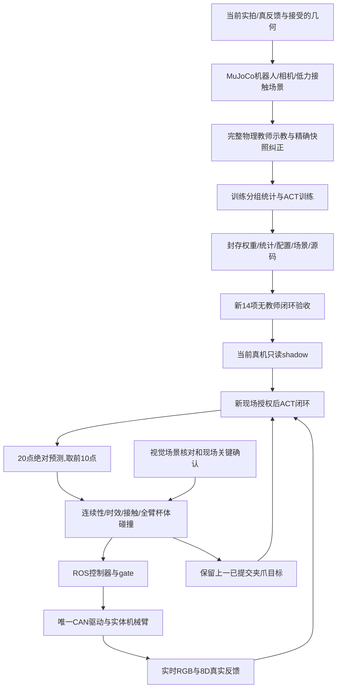

> 当前目标已改为一次受监督的 ACT 迁移可行性演示，独立入口及最新准备证据见 [迁移演示说明](../nero_act_transfer_feasibility_20261017/README.md)。下文保留原严格评估方案与历史记录。

# NERO 完整 ACT 仿真到真机

本包目标是让 ACT 连续完成接近、抓取、抬升、转运、放置、释放、退出。运行时的任务运动及夹爪目标来自 ACT；接触阶段另有明确记录的反馈姿态保持保护，YOLO/颜色仅核对场景和杯子结果，MoveIt 仅做状态、碰撞检查及轨迹传输。

**当前尚未完成 ACT 真机抓放验收。** 最新状态以 [执行记录](evidence/progress.md) 和对应 `evaluation/*/summary.json` 为准。历史教师抓放成功不能算本包 ACT 成功，首块 shadow 通过也不能算完整策略就绪。

run10已完成20轮微调、验证集选11轮；修复首次闭爪确认触发后，开发仿真完成约193mm抬升及179mm搬运，但释放停滞，仍不可部署。run11已完成20轮、验证集选择6轮，受监督冻结新14项最终 **6/14**，仍不可部署；对应失败与源码均保留，已加入抓取区逐点重观测保护，run12已在52条数据上完成20轮、验证集选3轮，开发场景未建立持续夹持，仍不可部署。run13按观测歧义的实际失败增加过去夹爪目标上下文，已完成正式20轮训练、验证集选14轮，正在完整开发仿真与真实输入只读核对；新14项尚未开始。原无人工暂停的冻结评估为run4 **4/14**、run5 **4/14**、run6 **1/14**、run7 **7/14**、run8 **8/14**、run9 **13/14**，均不可部署。run9已完成30轮微调、验证集选取27轮；500ms延迟仍未完成退出。执行层新增暂停、接触保持、持续杯体碰撞检查后，必须另作完整受监督协议评估，旧13/14不能替代。这次结构变化及验收要求见 [技术修订记录](../docs/superpowers/specs/2026-10-17-nero-act-feedback-head-addendum.md)。不能沿用旧模型成绩。

## 数据和方法

| 环节 | 本包使用的方法 | 证据/代码 |
|---|---|---|
| 现场输入 | ROS 真反馈七轴 rad + 夹爪总宽 m；独立只接收 SDK 交叉核验；run13另读上一已提交夹爪目标；ZED RGB 倒装旋转180°一次 | `evidence/current_source_capture/`、`evidence/feedback_source_sdk_health.json` |
| 场景对齐 | 保留机器人刚体/网格、标定相机、名义 TCP；同 q 的 MuJoCo 与 MoveIt FK 对比 | `simulation/scene.py`、`evidence/fk_alignment.json`、`evidence/current_profile_fk_alignment.json` |
| 对象几何 | 离线/只读 YOLO cup 身份 + 黄色轮廓 + 唯一蓝色四边形；已知杯尺寸/桌面假设下射线/平面和圆柱拟合 | 原 `nero_pick_place_20261016/perception.py`；本包 `SceneObserver` **不调用 transfer_plan** |
| 仿真示教 | 数值 IK、笛卡尔插值、延迟 PD/力矩伺服；两指各≤1N，真实接触产生搬运，无物体绑定或途中重置 | `simulation/teacher.py`、`nero_domain_randomization.py` |
| 接触求解 | MuJoCo3.15，elliptic cone、impratio10、Newton tolerance1e-10；保留50g、摩擦0.6 | `simulation/scene.py`、`evidence/contact_solver_study.json` |
| 保存和审计 | 控制前观测、同周期 float32 实际执行目标、阶段、RGB、qpos/qvel/外力；精确重放和十点合同双验收 | `simulation/collect.py` |
| ACT 学习 | 复用保留的 ACT 实现，冻结视觉骨干；20步全监督、前10加权；训练集统计；接触/释放/退出采样 | `training/train.py`、`policy_source/` |
| 闭环修正 | 删除不可辨识的静止接触等待、张开等待及释放指令空程前缀；run6加入精确物理状态的抓取/搬运/放置/退出纠正；所有局部样本单独标注 | `complete_windows`、`simulation/snapshot.py`；34条当前局部纠正不算完整示教 |
| 连续性学习 | run5余量损失未解决失败；run7改为训练/推理共用的平滑反馈残差读出，仍输出绝对目标 | `prefix_margin_penalty`、`executor/model.py`；v1的8mm范围不能表示约41%实际加权训练夹爪标签，v2按训练数据改为9.5mm/29.5mrad，独立10mm/30mrad拒绝门槛不变；任务成功仍须独立验证 |
| 冻结评估 | ACT读取每次新渲染和实测8D反馈；专家只供离线示教，不参与评估动作 | `simulation/evaluate.py`、`simulation/outcome.py` |
| 真机 shadow | 持久 ACT/相机进程 + 真实ROS反馈；无动作客户端/控制发布者/SDK发送 | `executor/shadow.py` |
| 执行保护 | 原始预测连续性、逐点限速、全机器人/持杯碰撞、完整健康反馈、接触/现场阶段确认、独占控制 | `executor/contract.py`、`contact.py`、`phases.py`、`gate.py`、`ros_execution.py`；闭/松爪期间保留杯体，仅两指允许接触 |
| 证据封存 | 权重、统计、训练配置、场景及完整评估依赖共同绑定；最终完整性校验成功才发布complete/finalized | `executor/evaluation_integrity.py`、`permission.py`；复制/改名同一授权仍只能启动一次 |
| 结果验收 | 实际关节运动、现场抓牢/离桌/承托/站稳确认、末端退出、连续新图像稳定观察；控制器成功本身不够 | `executor/runtime.py`；最终还需外部验收和恢复只读记录 |

接触求解器选择依据见 [MuJoCo 建模说明](https://mujoco.readthedocs.io/en/stable/modeling.html)：本次调整求解精度，没有通过增加夹力/摩擦或绑定杯子制造成功。MoveIt 空 group 的检查覆盖全机器人，语义见 [PlanningScene 接口](https://github.com/moveit/moveit2/blob/main/moveit_core/planning_scene/include/moveit/planning_scene/planning_scene.hpp)。

## 当前场景与边界

当前配置为 `training_data_current_source/scene_config.json`，由最新配对只读采集建立。旧 `scene/config.json`、旧模型和失败结果保留。发现历史起点与当前反馈不同后，独立 SDK 与 ROS 已交叉核对，重新训练使用当前起点，没有移动真机去套旧起点；历史快照与当前姿态差异的来源仍未确定，现有证据不能证明这期间实体移动过。

[反馈来源复核](evidence/feedback_source_recheck.json)中，10次独立SDK/ROS采样最大关节差约0.005°，真实反馈发布者只有`agx_arm_ctrl_single_node`；`/control/joint_states`仍是旧姿态的虚拟控制桥。检查期间CAN TX为240992→240992。**虚拟桥已在真机路由完全断开条件下同步，实体CAN TX未变化。** 旧记录中的虚拟姿态不能作为实体起点；同步后已与真实SDK/ROS复核到约0.005°一致。当前真实反馈的订阅者为robot_state_publisher与MoveIt内部状态监控，虚拟控制话题当前订阅者0；follow=true只选择状态监控话题，不会自动写入mock控制器内部姿态。

桌高 base Z=0mm、link7→TCP `[152,0,-23.5]mm` 是用户接受的近似参数，**不是独立实测标定**。杯体95×75mm/50g、相机外参、伺服和摩擦均有模型假设。只读几何拟合不能把这些假设变成实测值，因此接触阶段仍保留人工观察确认。

- 输入：单 RGB，90×160；8D实测状态为 joint1..7(rad) + 实际总开口(m)。run13再加入上一已提交夹爪目标与实测开口之差，编码特征共9维；physical/state/action接口仍为8维。
- 输出：绝对目标20×8，每次最多执行前10点，标称20Hz。
- 保护：每点≤0.002rad/0.5mm；原始前10点相对观测≤0.03rad/10mm；物理限位保持。
- 时效：发送前≤250ms，动作块尾≤750ms；确认后重新采集/推理，不消费等待前的预测。
- 全幅任务连续累积执行，没有0.005rad总幅度限制。关键接触确认不等于每个小角度都需确认。
- 单一ROS驱动发送CAN；独立SDK观察器的单发、批发、底层send三入口均封锁。
- 失败停止新发送、关门并取消两组轨迹，不自动回位、重试、复位或失能。软件取消不保证实体瞬停。

## 当前数据划分

当前场景共18条完整物理示教：基础0..11，加收紧超前量后的延迟30..35。全部经过物理任务、原始前缀合同和精确重放验收。

- train：0..7、30..33；val：8、9、34、35；diagnostic：10、11。
- 统计只取 train；当前场景从头重算统计，后续同场景微调沿用这份统计。
- 旧延迟20..25虽然物理抓放成功，但未通过前缀合同，排除出训练。
- 旧退出修正12..19是局部任务，未冒充完整示教，也未混入当前场景训练。
- run6时12条局部纠正：70、71、73、74、82、83、86、87为train；72、75、84、88为val。均从完整MuJoCo积分状态及伺服延迟队列恢复，精确重放和实际保护后目标审计通过；`full_task_verified=false`。清单为 `accepted_snapshot_recoveries.json`，50/76等被拒尝试仍保留。
- 原始数据目录不可覆盖；失败和被拒示教保留。

run9增加的局部数据清单为`accepted_snapshot_recoveries_v3.json`：原12条加100..108九条，共21条（14train/7val）。100、101来自run8基准超调，102、103来自independent_5；104、105为独立来源的val；106为500ms延迟退出train，107为独立退出val，108为100ms延迟搬运train。新增样本全部物理验证、十点合同和精确重放通过，最大qpos误差0；它们仍不能算作完整抓放示教或ACT自主成功。

run10的数据清单为`accepted_snapshot_recoveries_v4.json`：新增110/111(train)、112(val)三条精确承托松爪/退出样本，114(train)为500ms延迟下的源位下降至退出局部样本，共25条局部、18条完整。总43条中train29、val12、diagnostic2。113因4秒低速闭爪不足而拒绝并保留；114采用已有8秒闭爪等待通过，未覆盖113。四条新增样本全部物理/前缀合同/精确重放通过，误差0。仍不计完整ACT策略验收。

run12使用`accepted_snapshot_recoveries_v6.json`：在原25条局部数据上加入115..122八条精确失败状态纠正和123一条v7开发名义释放纠正，共34条局部+18条完整，总52条（train35、val15、diagnostic2）。新增9条全部物理、原前缀合同及精确重放通过，重放误差0；原43条文件哈希不变。首次抬升的离线教师保持当次测得的抓取姿态，运行时仍无IK。旧失败及各版清单均保留。

当前 `.venv` 复用只读依赖并独立安装MuJoCo3.15.0，不修改原环境。**ROS CAN驱动使用 `/usr/bin/python3`**，与当前ROS安装SDK相匹配；ACT模型、训练和相机worker使用本包 `.venv/bin/python`。已发现教师环境SDK缺少ROS节点所需的 `resolve_firmware_profile`，不能把两个解释器随意替换。

## 同一ACT如何从仿真进入真机

本包复用ACT编码器/解码器和已有初始化权重，使用单相机ResNet18视觉骨干（冻结）、128维隐藏层、两层编码/解码、20点动作块。当前适配器是**prior-only行为克隆训练**：训练与推理都从图像和状态直接预测，不输入教师未来动作构造训练后验；损失为20点L1、前10点加权5倍，KL项为0。这是本包的ACT训练适配，不能写成另一次π0.5训练、强化学习或未经修改的原论文CVAE训练。

八维实测状态归一化为`(qpos - qpos_mean) / qpos_std`，动作监督使用配套八维action统计。run13额外编码`(previous_gripper_target - actual_width)/0.01m`，配置明确state_dim=8、physical_state_dim=8、policy_input_dim=9；额外特征没有伪装成新传感器或第九轴。统计只由训练数据产生，后续同场景微调沿用；物体真值和阶段标签用于采样/物理验收，不作为8D策略输入。关节传感增强±0.2mrad、夹爪±0.1mm；完整示教覆盖初始姿态/物体位置/外观差异，冻结评估另外覆盖节拍、延迟和外力。

共享模型把解码器内部值经训练过的平滑反馈残差层变成**绝对目标**。v2前10点范围29.5mrad/9.5mm，后10点两倍，并与原物理限位相交；范围覆盖已接受训练标签，梯度在训练时经过同一公式。仿真评估、真实shadow及最终执行都加载同一权重、统计、配置及源码；没有“仿真用ACT、真机另换抓放规划器”的动作路径。



仿真教师的IK只生成训练监督；评估和执行不调用该IK生成动作。YOLO/颜色测量只核对源杯、蓝卡及最终站稳，MoveIt只检查ACT动作的状态/碰撞并承载轨迹。确认等待期间保留监控，恢复后重新读RGB与关节，不消费旧块。每块步长小是20Hz限速要求，连续完整任务仍包含约200mm升降和约178mm当前场景搬运，没有0.005rad总幅度限制。

## 接触执行协议与保护性保持

完整仿真不能只验证无暂停的ACT轨迹。本包额外执行GRASP、CARRY、RELEASE、RETREAT四次4秒模拟现场等待，GRASP/RELEASE再作2秒参考稳定；恢复后重新渲染/读实测状态并推理。模拟确认来自物理真值，绝不能形成真实现场receipt。等待与反馈参考转换另记，不占4300点ACT任务预算，最终100点稳定观察另计。

接触时旧目标可能与实测姿态存在伺服偏差，单纯保留旧目标仍可能在松爪后移动。保护层以原2mrad/点限制，把手臂参考平滑交接到同一次实测姿态，夹爪保持此前目标，再由ACT新预测闭/松爪。保持期检查实际TCP相对交接前位置≤3mm；闭爪稳定前、松爪分离前冻结七轴参考。这个`feedback_safety_hold_not_ACT_task_action`必须单独记录，不能称为ACT生成的任务轨迹。

ACT在名义抓取高度55±2mm前若提前收指，只保持此前开口，下降七轴仍由ACT产生；原PhaseGuard先检查粗略抓取区域。进入该高度后第一次请求闭爪就先等待GRASP，不能等到预测开口小于85mm才确认，否则会与开口保持规则形成僵持。杯体在原位台面支撑、指间稳定但尚未抬升时保留世界杯体；首个向上ACT点前转为附着碰撞体。不会向物理MuJoCo杯添加绑定约束。

固定附着几何可能与指间实际杯位不同。预测杯体将穿桌时，碰撞点不执行；若当前处于原有低位放置区域且在目标20mm内，只请求确认杯底是否已承托。仿真必须由实际台面接触/直立/目标位置判定，真机必须由现场RELEASE确认。确认后才更新世界杯体、作姿态参考保持并重新查询ACT；杯子悬空就停止，不能自动继续下降或绕过碰撞。详见[执行协议修订](../docs/superpowers/specs/2026-10-17-nero-act-contact-protocol-addendum.md)。

[上一版本释放停滞轨迹图](evidence/run10_v6_motion_diagnostic.png)展示了完整抬升和搬运后的失败，不能算完整任务成功。

释放还有一段指令空程：目标从65mm上升到约74mm时，杯壁仍把实际开口保持在约74mm，图像也几乎不变。训练若反复监督这段缓慢增加但实际无变化的目标，单帧策略可能不断重新输出约70mm而不张开。run11只排除静止release阶段“目标仍低于实际开口超过0.5mm”的起始训练窗口；原始动作与重放记录不改，能实际打开的窗口和退出保留。运行时限速器从真实上一目标连续推进，不把历史改写成测量值，不下发预设张爪命令。证据为`release_deadband_input_audit.json`和`unchanged_feedback_release_reference_progress.json`。这仍须新的完整物理验收，不能据训练采样修复直接宣称成功。

run13为此增加一维过去指令输入：训练读取action[t−1,7]，初始帧读取精确快照previous_target或完整示教的初始保持目标；推理读取session.last_target，即原限速/保护后已提交值。它让策略区分“上一条闭爪目标仍未反映在实际开口上”的进度。新训练重新保留释放空程样本；夹紧后纯等待、完全张开纯等待仍排除。图像、实际状态、上一指令参与当前ACT推理，动作仍为新的20×8绝对预测。

保留原ACT源码，状态投影两矩阵从8列扩为9列，原列原样复制、新列零初始化，再训练。扩维初始化文件单独标记initialization_only，禁止作为执行模型导出。九项新增测试验证因果性、缺少上下文拒绝、真实提交目标传输、零列兼容和梯度、增强后的历史一致性；完整101项默认测试通过，另有一轮完整GPU训练联调。详见[上下文修订](../docs/superpowers/specs/2026-10-17-nero-act-command-context-addendum.md)。它是新的训练模型，不能沿用旧14项成绩。

## 可复核命令

工作目录为本包根目录。以下测试默认不连硬件：

```bash
MPLCONFIGDIR=/tmp/nero_full_act_mpl PYTHONDONTWRITEBYTECODE=1 .venv/bin/python -m unittest discover -s tests -v
```

完整物理教师测试可显式运行：

```bash
NERO_PHYSICS_TEST=1 MPLCONFIGDIR=/tmp/nero_full_act_mpl PYTHONDONTWRITEBYTECODE=1 .venv/bin/python -m unittest tests.test_teacher -v
```

当前场景训练示例（`--run`必须新名称）：

```bash
MPLCONFIGDIR=/tmp/nero_full_act_mpl .venv/bin/python -m training.train --epochs 20 --run NEW_RUN --data-dir training_data_current_source --supplemental-full training_data_current_source/delayed_tight_manifest.json --corrections training_data_current_source/accepted_snapshot_recoveries_v6.json --init-checkpoint training/run12_full_contract_recovery/checkpoints/policy_best_val.ckpt --bounded-feedback-head --previous-gripper-context
```

模型必须完成声明轮次后导出到新目录，再冻结评估：

```bash
.venv/bin/python -m training.export --checkpoint training/NEW_RUN/checkpoints/policy_best_val.ckpt --output model/NEW_MODEL
MUJOCO_GL=egl MPLCONFIGDIR=/tmp/nero_full_act_mpl .venv/bin/python -m simulation.evaluate --checkpoint model/NEW_MODEL/policy.ckpt --output evaluation/NEW_EVALUATION --seed-offset NEW_FRESH_OFFSET --supervised
```

14项固定工况为基准1、独立扰动8、查询节拍1、100/500ms伺服延迟2、外力2。结果同时要求物理任务和执行合同通过。发现失败用于改进后，下一次使用新的独立种子，旧结果不重判。

评估须使用完成导出的冻结包；权重、统计、场景和训练配置逐项校验，源码变动或最终校验失败时结果明确保持不完整。旧摘要缺少新协议的统计/配置绑定和finalized字段，保留作历史诊断，不能授权新运行。

历史run4使用3200点/160s截止，结果4/14。当前延迟教师最长训练示教3371点，已在run5训练前按训练示教最长时长125%、向上取整100点，固定新模型4300点/215s总任务预算；最后100点稳定观察另计。每块时效和物理成功标准未调整。

运行现场只读 shadow 需ROS网络和ZED：

```bash
source /opt/ros/jazzy/setup.bash
source /home/user/projects/nero_ros2_ws/install/setup.bash
export ROS_DOMAIN_ID=42
.venv/bin/python -m executor.shadow --model model/NEW_MODEL --output evidence/NEW_SHADOW --queries 5
```

当前shadow的`success`只说明采集/推理链完成，另须逐条检查`prefix_contract_issue`为空。这个报告语义问题已列为代码审查的待修次要项；不能据`success`一个字段认为模型已通过前缀合同或完整流程。

默认执行入口也只读文件，不连接硬件：

```bash
.venv/bin/python run.py --model model/NEW_MODEL --evaluation evaluation/NEW_EVALUATION/summary.json --output evidence/NEW_OFFLINE_REPORT
/usr/bin/python3 -m executor.driver
```

## 真机执行层的顺序

此部分只有模型14/14、当前shadow/几何和源码复核通过后才可使用。本包没有现成可复用的真机授权。

只读联调已实证两个执行层问题并修正：40个碰撞请求突发会丢失响应，改为最多8个在途后约9ms完成40点；全机器人检查原先拒绝固定基座/桌面零深度接触，现只在验证world→base_link全固定且水平桌面高度匹配后处理这一个固定接触对。运动连杆/桌面检查仍保留。隔离Domain43、禁用轨迹执行且无CAN驱动的真实MoveIt测试，六个杯体场景阶段全部通过；这些是软件联调，不是实体动作验收。证据为`readonly_collision_latency_bounded8.json`、`isolated_cup_scene_probe2/report.json`，检查期间CAN TX保持240992。

1. 核对当前RGB/实测反馈、空杯源位、蓝卡、急停和单一控制权；形成绑定权重、统计、训练配置、scene哈希及本次 `ACT_FULL` 的一次性现场receipt。
2. 在发送封锁、gated发布者0时，把**虚拟控制桥**同步到真实反馈。不能让真机去追旧虚拟姿态。
3. 按本次授权切换到一个ROS发送驱动（5%/200Hz/smoothed、auto_enable=false、初始control gate关闭、夹力1N）。驱动入口校验冻结评估和当前receipt；SDK观察器始终不能发送。
4. 启动本包接触gate：先确认关门ACK；心跳/反馈过期即关门；持物间隙只在当前GRASP许可和低力新鲜反馈下允许；不能通过放宽一般同步容差通过。
5. 显式 `run.py --execute` 再次验证模型/评估/源码/新鲜几何，在固定`evidence/authorization_attempts/`中按规范化授权内容摘要排他创建执行标记。同一receipt复制、改名或换输出目录均不能重新开始。
6. ACT持续查询和执行完整幅度路径，仅保留 GRASP、已离桌CARRY/NEXT、已承托RELEASE、已站稳RETREAT/NEXT 的关键确认。相机、完整SDK健康反馈在等待期间继续采样；恢复后使用新预测。
7. 源杯、附着持杯、放置后的世界杯体连续参与碰撞检查；GRASP后只允许两根手指接触杯壁，其余连杆始终检查。RELEASE后用新观测明确更新已承托世界杯体；两指张开且现场确认后恢复指/杯碰撞检查再退出。几何只生成碰撞体，绝不生成抓放目标。若ACT预测越界/碰撞/未承托释放则停止，不转交教师。
8. 结束后关闭发送、取消轨迹；停止本次发送驱动和gate，恢复三个发送入口封锁的只接收驱动。补充真实反馈、最终照片和CAN TX证据后，才形成外部验收。当前源码包638项已封存并复核，借用原代码未变化；封存不等于硬件授权或二进制环境认证。

`report.json` 的 `task_outcome_candidate` 仍须最终现场/日志核查；`read_only_restoration_pending=true` 表示收尾未完成，不能作为最终验收。代码已有一次独立审查及四项重要修复；最新101项离线测试通过（其中2项物理显式启用测试跳过），其后接触执行协议修订由作者验证，尚无第二次独立审查。上述实现尚需合格模型、当前只读联调、包封存及一次真实 ACT 全流程验证。

完整变更和每次决策见 [progress.md](evidence/progress.md)。原已完成的 [教师抓放验收](../nero_pick_place_20261016/acceptance.json) 只作参考，不计入本包 ACT 成绩。
