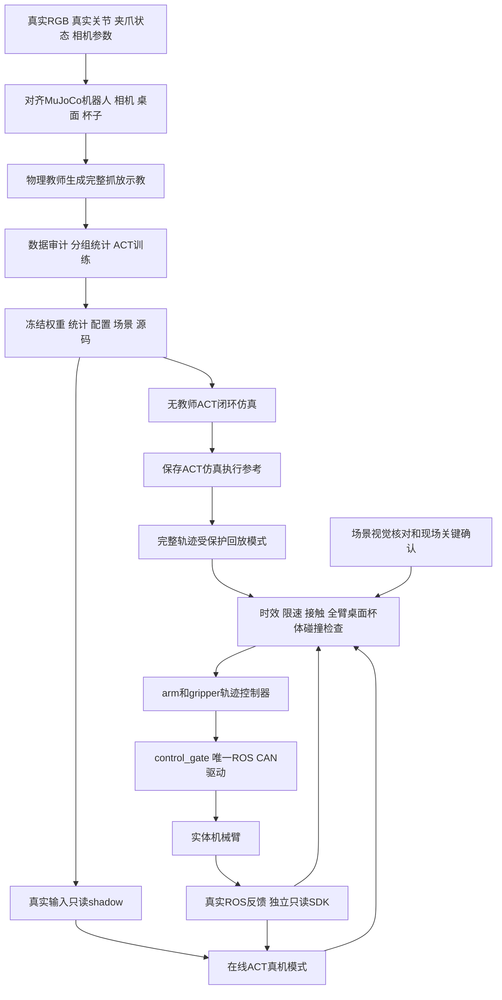

# NERO ACT 仿真到真机迁移全过程

2026年10月21日最新复检：已完成监督冲突核验与固定/线性衰减两组各1000步离线对照。423帧接近参考的七轴RMS漂移分别0.00779、0.00484毫弧度，均达保持门槛；两组局部恢复仍为4/6，名义状态未建立或维持原3毫米闭合余量，未进入本轮高位完整抓放、正式训练或真机。两组组件测试均421通过/5跳过；这不代表策略任务通过。详见[本轮完整结果与数值复盘](nero_act_optimizer_control_20261021/evidence/results.md)、[试验核验](nero_act_optimizer_control_20261021/evidence/pilot_verification.json)。上轮记录保留于[接近保持报告](nero_act_approach_preservation_20261021/evidence/results.md)。下文保留历史过程。

整理日期：2026年10月18日。记录范围：本次黄色空杯从源位抓取、抬升、搬运到蓝卡、放置、释放和退出的仿真训练及真机迁移实验。

**目前已验证：仿真训练的 ACT 能接收真实图像和真实关节反馈，并通过 ROS/CAN 驱动机械臂完成大幅接近；冻结 ACT 也已在 MuJoCo 中完成完整抓放。尚未验证：本次 ACT 在真机上完成夹杯、搬运、放置的全过程。** 后来的仿真轨迹回放尝试完成了真机完整接近，并开始闭爪，但在稳定夹持成立前因状态接收超时停止，尚未抬升。

本文先说明方法和数据流，再按实际执行顺序说明结果。早期 MoveIt 教师抓放成功单独列为背景，不计入 ACT 真机成功。

## 1 本次迁移究竟迁移了什么

本次先迁移策略，再尝试迁移动作轨迹，经历了两种 ACT 模式。

| 模式 | 真机任务动作的来源 | 真机是否重新查询 ACT | 本次结果 |
| --- | --- | --- | --- |
| 在线 ACT 迁移 | 冻结模型根据当前真实 RGB 和8维实测状态生成动作块 | 是，每次最多执行前10点，再重新观测 | 已有真实大幅运动；一次因确认超时停止，另一次到杯旁后持续预测张开，未夹杯 |
| ACT 仿真轨迹真机回放 | 同一冻结 ACT 在 MuJoCo 成功运行时保存的执行参考 | 否；视觉与反馈用于核对和保护 | 已完成真机完整接近并开始低力闭爪；接收超时停止，未建立稳定夹持 |
| 早期 MoveIt 教师抓放 | 视觉定位、几何目标和 MoveIt 规划 | 不属于 ACT 模型控制 | 历史记录有完整实物抓放成功，不能归为上述两种 ACT 的成功 |

在线模式的迁移对象是“模型、归一化、图像处理、状态/动作接口、执行协议”；回放模式的迁移对象是“ACT 在仿真中实际施加过的完整参考及其必要保护协议”。两者都需要仿真与真机的机器人、坐标、夹爪含义和起点一致。

用户在在线闭爪失败后明确选择“先完成 ACT 仿真轨迹真机回放”，并要求本轮必须实际夹杯搬运放置。因此当前没有将空载回放作为替代验收。

## 2 总体链路和各组件的职责



各工具不是互相替代的控制方案，它们在链路中承担不同工作：

| 组件 | 本次用途 |
| --- | --- |
| MuJoCo | 场景重建、接触物理、示教采集、冻结策略闭环评估、轨迹接触物理复核 |
| ACT | 学习并预测七轴和夹爪的绝对目标序列 |
| ZED | 提供真实场景 RGB，输入 ACT，并用于独立场景核对 |
| YOLO、黄色轮廓、蓝色四边形识别 | 识别源杯和蓝卡，核对位置、变化和放置结果 |
| 数值 IK 与笛卡尔插值 | 仅在离线仿真教师中生成训练监督 |
| MoveIt | 在 ACT 迁移阶段检查全机器人、桌面、杯体和持物路径；不生成替代 ACT 的抓放轨迹 |
| ros2_control | 承载 arm/gripper 的 FollowJointTrajectory 目标；当前控制桥使用 GenericSystem |
| control_gate | 在控制器和真机驱动之间实施同步、时效、心跳、接触和停止门控 |
| ROS 驱动 | 唯一允许发送真实 CAN 控制帧的进程 |
| 独立 SDK 观察器 | 全部发送路径封锁，仅接收真实健康和关节/夹爪反馈，交叉核验 ROS |
| RViz | 显示机器人和场景。本轮运行设置 use_rviz=false，RViz 显示不是运动验收证据 |

ACT 运行代码会复用 `nero_methylene_teacher.py` 中的只读定位方法，但不调用其中的抓放规划来接管 ACT 动作。接口边界见 [SceneObserver](nero_act_sim_rollout_replay_20261017/executor/runtime.py)。

## 3 环境和工程目录

本次完整任务环境记录为 Python 3.12.3、MuJoCo 3.15.0、Torch 2.5.1+cu121、torchvision 0.20.1+cu121、NumPy 2.5.2、h5py 3.16.0；仿真渲染使用 EGL。版本来源：[环境记录](nero_act_full_pick_place_20261017/evidence/environment.json)。

| 项目 | 实际位置或设置 |
| --- | --- |
| 任务训练与仿真工程 | `/home/user/wq/nero_act_full_pick_place_20261017` |
| 在线迁移第一次实验 | `/home/user/wq/nero_act_transfer_feasibility_20261017` |
| 在线迁移后续实验 | `/home/user/wq/nero_act_transfer_completion_20261017` |
| 当前 ACT 仿真轨迹回放工程 | `/home/user/wq/nero_act_sim_rollout_replay_20261017` |
| ACT、仿真、相机解释器 | `/home/user/wq/nero_act_full_pick_place_20261017/.venv/bin/python` |
| ROS CAN 驱动和保护门解释器 | `/usr/bin/python3` |
| ROS | ROS 2 Jazzy，`/opt/ros/jazzy` |
| ROS 工作区 | `/home/user/projects/nero_ros2_ws` |
| 真机 ROS 域 | `ROS_DOMAIN_ID=42` |
| 隔离合成 ROS 验证域 | `ROS_DOMAIN_ID=43` |
| 机械臂与 CAN | NERO/V120，7轴，`can0`，1 Mbps |

模型环境与 ROS 驱动环境分开，是因为旧教师解释器中的 SDK 与当前 ROS 节点接口不完全兼容。不能为了统一命令而随意互换解释器。

## 4 第一步 从真实场景建立一致的仿真起点

### 4.1 先确认读到的是真实机械臂

现场同时存在两组容易混淆的状态：

- `/feedback/joint_states`：真实 ROS 驱动发布，必须与独立 SDK 实测一致。
- `/control/joint_states`：GenericSystem 控制桥输出，可能仍保留上次轨迹的中途位置。

排查过程中曾出现 J2、J7 相差几十度的起点。独立 SDK 与真实 ROS 反馈一致，而虚拟桥不同，说明不能用虚拟控制器位置替代实体起点。`follow=true` 选择状态监控输入，不会自动把真实位置写入 GenericSystem 内部。

处理方法是：先停止真实驱动、确认物理控制路由不存在且硬件插件全部是 GenericSystem，再只同步虚拟关节到实测姿态。过程中 SDK 保持全部发送封锁，检查真实姿态及 CAN 计数不变，最后恢复只读真实驱动。这个操作是虚拟桥初始化，不是真机动作。

证据：[反馈来源说明](nero_act_full_pick_place_20261017/evidence/feedback_source_findings.md)、[独立复核](nero_act_full_pick_place_20261017/evidence/feedback_source_recheck.json)、[虚拟同步实现](nero_act_sim_rollout_replay_20261017/executor/virtual_bridge.py)。

### 4.2 统一状态和动作接口

物理状态和动作始终为8维：

```text
[joint1, joint2, joint3, joint4, joint5, joint6, joint7, gripper_total_width]
 前七维单位 rad                                   最后一维单位 m
```

最后一维是两指总开口。ACT 反归一化后输出绝对关节位置和绝对开口，不能把输出再次累加到当前姿态。MuJoCo 的两指内部坐标与该总宽度转换后再施加。

本次采用的冻结 run11 原始起点约为：

```text
七轴 rad = [0.183260, -0.126519, 0.100025, 1.570796,
            -0.023859, 0.281679, 0.130987]
夹爪总开口 = 0.094389 m
```

旧空中模型的100步输出接口不能直接代替本次20步接口；必须同时匹配权重、统计、模型源码和 schema。

### 4.3 对齐机器人坐标和 TCP

保留机器人刚体链、网格、关节顺序及限位，对相同 q 分别计算 MuJoCo 和 MoveIt 的 link7 FK，核对位置与旋转矩阵。本次同 q 的数值结果接近机器精度，说明两套模型的坐标实现一致；这不能证明实体 TCP 已经独立标定。

TCP 换算为：

```text
p_base_tcp = p_base_link7 + R_base_link7 × offset_link7_tcp
```

当前使用用户已接受的近似参数：桌面 `base Z=0 mm`，link7 到夹持中心 TCP 为 `[152, 0, -23.5] mm`。杯模型高95mm、外径75mm、质量50g。历史135mm近似 TCP 在模型碰撞检查中被拒绝后，才改用上述名义 TCP；没有把模型一致性或图像拟合写成独立实测验收。

证据：[当前起点 FK 对齐](nero_act_full_pick_place_20261017/evidence/current_profile_fk_alignment.json)、[冻结场景](nero_act_sim_rollout_replay_20261017/model/frozen_run11/scene_config.json)。

### 4.4 对齐相机与物体

ZED 倒装图像旋转180°一次，模型输入为 RGB、90×160。现场采集及定位使用640×360图像；内参随分辨率对应。由旋转后的像素做光学投影时，需要映射回原始光学像素，不能重复旋转或直接套错内参。

物体核对采用 YOLO 的 cup 身份、黄色杯体轮廓、唯一蓝色四边形，在已知杯尺寸及桌面高度假设下进行射线/平面和圆柱拟合，再通过相机外参转换到机器人基座坐标。

原训练源位约 `[-525.155, 15.591] mm`，蓝卡目标约 `[-524.743, -162.056] mm`。仿真相机使用保留的内外参重建，并调整基本颜色、背景和光照；杯柄、印花、真实背景及伺服响应仍存在差异，没有完成全面域适配。

## 5 第二步 在 MuJoCo 中生成完整物理示教

示教教师按高位接近、下降、闭爪、抬升、搬运、下降放置、释放、退出的顺序，用数值 IK 和笛卡尔插值产生目标，再由带延迟的 PD/力矩伺服执行。杯子靠双指接触和摩擦被搬运，不在中途重置位置，也不使用物理约束把杯子粘在夹爪上。

控制周期为50ms，物理积分步长2ms；手指低力配置每指不超过1N。模型保留0.6摩擦系数，采用 elliptic 接触锥、impratio=10 和1e-10求解容差，降低低力接触下的数值滑移。没有通过增加摩擦或夹力制造任务成功。

每个示教同时满足三层检查：

1. **物理任务**：有真实抬升、非零搬运、目标处承托释放和退出后稳定。
2. **动作合同**：绝对目标、原始预测窗口/参考的连续性以及单点限速符合执行约束。
3. **精确重放**：从相同积分状态和伺服延迟队列重新执行保存的 float32 动作，核对状态一致性。

采集先保存控制前观测，再执行同周期动作，避免把动作后的状态错配为动作输入。HDF5 包含：

```text
action                          [T,8]，实际执行的float32绝对目标
timestamp                       仿真时刻
observations/qpos               [T,7]
observations/gripper_state      [T,1]，两指总开口
observations/images/camera_0    [T,90,160,3]，RGB
observations/object_xyz          用于审计，不作为run11策略输入
simulation/qpos、qvel、stage、external_arm_torque_nm
```

训练数据的图像每10个控制周期更新一次，即2Hz，其他周期保留图像；状态/动作仍按20Hz记录。在线执行的名义重新查询间隔也是10点，但实际推理与通信耗时需另记，不能把名义20Hz写成已测得严格墙钟20Hz。

当前场景完整示教共18条：12条基础、6条收紧目标超前量后的延迟示教。run11另使用25条精确物理状态恢复的局部纠正数据，覆盖抓取、搬运、承托释放和退出失败。局部纠正不计为完整示教。

run11合计43条：29条训练、12条验证、2条独立开发诊断。训练包含12条完整示教及17条局部纠正；验证包含4条完整及8条局部；诊断2条完整。统计来自训练分组并在同场景后续微调中冻结沿用。失败、拒绝样本和旧版本均保留。

代码与数据依据：[教师](nero_act_full_pick_place_20261017/simulation/teacher.py)、[采集与重放](nero_act_full_pick_place_20261017/simulation/collect.py)、[run11数据清单](nero_act_full_pick_place_20261017/training/run11_release_deadband/manifest.json)、[训练/验证划分](nero_act_full_pick_place_20261017/training/run11_release_deadband/split.json)。

## 6 第三步 ACT 学习和冻结模型

### 6.1 本次实际使用的模型

ACT 用当前图像和实测状态预测未来动作块：

```text
输入：RGB[90,160,3] + state[8]
输出：未来20点绝对目标[20,8]
在线执行：最多取前10点，再读真实图像与反馈重新预测
```

run11复用现有 ACT 实现和前一训练版本初始化权重，单相机 ResNet18 视觉骨干冻结，Transformer 隐藏维128、前馈维512、8头、2层编码器、2层解码器。训练方式是本工程的 prior-only 行为克隆：训练与推理均由图像和状态直接预测，KL权重为0；不是强化学习，也不宣称完全照搬原论文的 CVAE 后验训练。

20个动作点全部参与L1监督，前10点权重为5，batch size=32，学习率1e-4，weight decay=1e-4。run11完成声明的20轮，约350.8秒，由验证集选第6轮，验证L1约0.0048596；没有按最终真机效果挑选 checkpoint。

### 6.2 归一化和反馈残差读出

实测状态使用配套训练统计归一化：`state_norm=(state-qpos_mean)/qpos_std`；动作使用配套 action_mean/action_std。权重与统计必须成对加载。

训练中加入关节约±0.2mrad、夹爪约±0.1mm的观测增强，并对闭爪、释放及纠正阶段重复采样。末尾窗口用 padding 保留释放和退出的监督。

run11使用训练/推理共用的 `feedback_tanh_v2` 读出：以同次输入的实测状态为锚点，平滑限制网络产生的目标偏差，并与物理限位相交。前10点的读出范围是七轴29.5mrad、夹爪9.5mm，后10点范围加倍。读出结果仍是绝对目标，执行端不得再次当成增量累加。

这与外层执行合同分开：原始前10点超过实测状态30mrad/10mm直接拒绝；通过后，每50ms最多按2mrad和0.5mm向目标推进。前者约束模型预测的局部连续性，后者约束实际施加速度；长期累计允许完整任务的大幅运动。

### 6.3 训练中实际处理的问题

| 发现的问题 | 使用的方法 | 保留的边界 |
| --- | --- | --- |
| 旧起点、场景与现场不一致 | 用当前真实输入重建场景、重新生成数据及训练统计 | 不让真机去套旧的虚拟姿态 |
| 原始动作块跳变 | 完整动作窗口监督、局部纠正数据、训练过的平滑反馈残差读出 | 不用整体缩幅替代任务，不强行接受大跳变 |
| 小读出范围不能表示部分训练夹爪标签 | 按训练数据审计修改读出范围并重新训练v2 | 外部10mm/30mrad拒绝门限保持 |
| 同一图像和状态对应静止等待中的不同指令 | 处理静止接触/张开等待窗口，并增加精确状态纠正 | 不把局部教师修正记为策略自主成功 |
| 放杯时指令增加但实际宽度仍被杯壁限制 | run11排除静止释放阶段尚在夹爪空程中的起始训练窗口 | 原始数据不改；运行时不补手写释放指令 |
| 后续模型仍有观测歧义 | run13探索加入上一已提交夹爪目标上下文 | run13是另一模型，未用于本次冻结run11回放 |

run12/13曾继续训练，但本次现场可行性实验最终使用的是 run11。不能把run13的9维编码输入描述为本次run11的输入；run11物理状态和策略输入均为8维。

依据：[训练摘要](nero_act_full_pick_place_20261017/training/run11_release_deadband/artifacts/training_summary.json)、[冻结训练配置](nero_act_sim_rollout_replay_20261017/model/frozen_run11/training_config.json)、[共享读出实现](nero_act_sim_rollout_replay_20261017/executor/model.py)、[训练迭代记录](nero_act_full_pick_place_20261017/evidence/progress.md)。

### 6.4 冻结时封存的内容

模型包同时绑定权重、归一化、训练配置、场景和推理源码。实际使用 checkpoint SHA256：

```text
47e220e102aaede593004678b3941db99287b07a9a1bc3245bd1e16c3246b6f4
```

元数据中的硬件部署和真机任务验证标志保持false。名义仿真通过不会自动改写成通用部署许可；现场实验另走有人监督、单次可行性授权。

## 7 第四步 冻结策略在仿真中闭环评估

冻结评估中，每次用新渲染图像和实测仿真状态查询 ACT，执行其动作前缀，再由物理环境返回新反馈。离线教师不参与评估动作生成；杯子真值只供结果监控及仿真接触协议使用。

评估同时看物理结果与执行合同：必须有双指接触下的抬升和至少100mm搬运、目标20mm范围内承托释放、退出到规定高度、至少100帧约5秒稳定，无提前释放、非预期碰撞和合同失败。杯子一开始就在目标上、抬升后滑落或夹住不释放均不能通过。

受监督协议还模拟 GRASP、CARRY、RELEASE、RETREAT 四次等待，并重新观测；仿真确认不是现场操作授权。接触期间的实测姿态安全保持另行标注，不能全部归为 ACT 原始动作。

严格评估包含14项：名义1项、独立扰动8项、查询节拍1项、100/500ms延迟2项、外力2项。**run11最终为6/14，不满足原严格14/14门槛。** 用户随后将目标改为观察单次迁移可行性，才建立独立实验入口；原严格入口和失败记录保留，没有改成“14/14已通过”。

本次修复后再次对冻结run11执行完整名义仿真，结果1/1：抬升约197.26mm、水平搬运约178.32mm、释放后稳定103帧，无非预期接触、无合同失败、无物理绑定。它证明该固定场景能完成全流程，不能代表抗扰动鲁棒性或真机成功。

依据：[run11严格评估](nero_act_full_pick_place_20261017/evaluation/run11_supervised_frozen/summary.json)、[最新名义仿真结果](nero_act_sim_rollout_replay_20261017/evidence/gate_receiver_fixed_frozen_nominal/nominal/result.json)、[评估实现](nero_act_sim_rollout_replay_20261017/simulation/evaluate.py)、[物理成功判据](nero_act_sim_rollout_replay_20261017/simulation/outcome.py)。

## 8 第五步 真实输入只读 shadow

shadow用同一冻结权重、统计和预处理，读取真实 ZED RGB、七轴实测关节和夹爪开口，产生20×8预测，并检查形状、有限值、物理限位、原始前缀连续性、限速与时效。此时没有任务动作发送。

独立 SDK 观察器封锁三条发送路径：底层 `CanCommImpl.send`、`ArmDriverAbstract._send_msg` 和 `_send_msgs`。同时核对反馈发布者、门控发布者和 CAN 发送计数，避免“只读”程序暗中使能或进入控制模式。

本次曾通过10次当前真实输入预测及后续恢复起点后的多次预测检查。shadow通过说明模型接口已接上真实传感器、当前前缀可接受；它不能证明闭爪、长程状态分布或最终放杯一定成功。

依据：[第一次迁移准备与结果](nero_act_transfer_feasibility_20261017/README.md)、[只读shadow实现](nero_act_sim_rollout_replay_20261017/executor/shadow.py)。

## 9 第六步 在线 ACT 真机执行及实际结果

### 9.1 在线动作如何进入真机

在线 ACT 每次输出20点绝对目标，通过合同后最多执行前10点，名义0.5秒。MoveIt检查 ACT 动作及中间插值的全机器人有效性，不重新规划一条抓放轨迹；目标分成 arm 和 gripper 的 FollowJointTrajectory，经过独立门控才可到唯一真实 CAN 驱动。

真实 ROS 反馈与独立 SDK 交叉核验，七轴差值超过3mrad或开口差超过2mm停止；健康、反馈时效和接触状态持续检查。命令转场5%、夹爪不超过1N。接触阶段单独保留 GRASP、离桌后的NEXT、落桌后的RELEASE、退出前的NEXT，不逐小角度确认。

### 9.2 第一次在线迁移

冻结run11实际完成58个动作块、580点，第59块因控制器确认未在原45ms期限内完成而停止。实测J2运动约52.62°、J7约61.72°，说明是真实大幅运动，不是仅在虚拟控制器中执行。尚未进入GRASP，未抓杯或搬运。

580点名义时长29秒，复核的实际执行时间约33.27秒；这些时间不能混写。按实测关节和名义TCP计算高度约从479mm降到115mm，这属于模型FK估算，不是独立距离测量。

随后修复停止锁存、ROS退出清理和只读进程保活，增加每端发送/确认时间戳。旧确认超时未在隔离实验中复现，因此不能断言该次根因已消除；45ms期限保持。

依据：[在线迁移结果](nero_act_transfer_feasibility_20261017/README.md)。

### 9.3 后续在线迁移到杯旁但未闭爪

新的在线尝试到达抓取位，收到现场GRASP。但255个抓取保持块中，ACT仍预测接近张开：原始目标约92.74～95.00mm，保护后约94.23～95.00mm，实测约94.875mm、力约0.035N，没有形成稳定夹持。

本轮没有补发手写闭爪指令来代替ACT。程序停止并恢复只读。652个控制器应答最大约4.03ms，本次没有复现前次确认超时；3240个完成点包含大量保持，不能称作3240个有效任务运动点。

这说明“名义仿真完整通过”和“真实输入当前前缀通过”仍不足以保证真实接触阶段正确。真实视觉外观、反馈分布和静止接触进度歧义是需要继续研究的方向；已有日志不足以把闭爪失败归为唯一确定原因。

用户随后选择先完成 ACT 仿真轨迹真机回放。

依据：[后续在线实验终态](nero_act_transfer_completion_20261017/README.md)。

## 10 第七步 提取 ACT 仿真完整轨迹并迁移回放

### 10.1 提取的是 ACT 执行参考

源文件来自同一冻结run11成功的无教师名义仿真：

```text
nero_act_transfer_completion_20261017/
  evidence/final_frozen_nominal/nominal/rollout.npz
```

当前副本为 [replay/act_rollout.npz](nero_act_sim_rollout_replay_20261017/replay/act_rollout.npz)，SHA256：

```text
cf8d81b26538588ca91f3522330e17ac0872bc3ffe56fff3436c1d70242f7205
```

执行参考键是 `sent_targets`，不是网络原始输出 `raw_chunks`。文件包含2655个参考点、每点50ms、名义132.75秒，七轴范围约J2 68.09°、J7 74.43°。实际运行还包括路径检查、人工等待和参考接入时间。

| 阶段 | 点数 | 名义时长 | 阶段前的真实条件 |
| --- | ---: | ---: | --- |
| approach 接近 | 800 | 40.00秒 | 真实起点、夹爪、源杯和蓝卡与当前执行场景一致 |
| close 闭爪 | 191 | 9.55秒 | 现场GRASP确认两指在杯壁两侧，且没有顶杯口/桌面 |
| lift 抬升 | 361 | 18.05秒 | 实测稳定夹持已建立 |
| carry_place 搬运及下降 | 610 | 30.50秒 | 现场NEXT确认杯已离桌、稳定且通道净空 |
| release 释放 | 193 | 9.65秒 | 现场RELEASE确认杯底已由蓝卡处桌面承托 |
| retreat 退出 | 500 | 25.00秒 | 实测已松开，现场NEXT确认杯独立站稳、两指分离 |

参考来源中有1211点标为ACT、800点为ACT手臂动作配合抓前开口保持、140点为ACT夹爪动作配合实测手臂保持，另有4点反馈安全保持、320点等待、80点参考稳定和100点完成保持。不能把2655点全部描述为未处理的神经网络输出。

具体来源、分段与哈希见 [manifest.json](nero_act_sim_rollout_replay_20261017/replay/manifest.json)。

### 10.2 真机回放中的保护变换

回放保留原幅度和任务顺序，只应用有记录的保护变换：

- 从实测起点按原限速连接首参考，避免数值舍入造成首点超限。
- 测得稳定接触后，将闭爪目标下限限制为接触开口减9mm，保留原12mm接触差保护。
- 承托释放时以实测七轴姿态作零运动参考保持，避免复制仿真特有的伺服偏差导致松杯时移动。
- 退出确认后按原限速连接回后续ACT参考。
- 若附着杯碰撞模型将穿过桌面，在第一个不安全点前停止该下降，不强行执行。

这些变换不是额外的教师抓放轨迹，也不是实时ACT预测，需要在日志中分别标识。

除最后退出外，各阶段末端附加300秒同位置保持，使现场确认期间目标仍有效。人工确认最多等待180秒，期间继续健康和心跳监督。这样避免控制器阶段结束后门关闭、随后因微小伺服偏差不满足严格1mrad重开条件而无法衔接。保持不会让机械臂额外前进；最终退出仍要求控制器正常结束。

依据：[回放执行](nero_act_sim_rollout_replay_20261017/executor/replay.py)、[分段与参考保护](nero_act_sim_rollout_replay_20261017/executor/replay_session.py)。

### 10.3 杯位偏差如何处理

用户明确接受“一点偏差”后，本轮以约9.63mm偏移的实测源位建立执行场景，保留原ACT动作不变。接受的源位约 `[-525.709, 5.976] mm`。

对此场景，分别重做原轨迹的接触物理和全路径碰撞复核：接触物理完成约196.92mm抬升、168.73mm搬运和103帧稳定；全机器人、桌面、杯体与多种接触保护开口检查通过。后续仍检查相对这个已接受场景的5mm稳定性；接受旧偏差不等于允许杯子在后续接触中继续移动而不复查。

依据：[偏差接受记录](nero_act_sim_rollout_replay_20261017/evidence/source_offset_acceptance.json)、[匹配接触物理](nero_act_sim_rollout_replay_20261017/evidence/accepted_offset_replay_physics.json)、[匹配碰撞检查](nero_act_sim_rollout_replay_20261017/evidence/accepted_offset_collision/report.json)。

## 11 第八步 真机执行保护与验收方法

| 项目 | 本次实际约束 |
| --- | --- |
| 物理控制者 | 单一ROS CAN发送进程；SDK观察器三条发送路径封锁 |
| 参考步长 | 七轴不超过约2mrad/50ms，夹爪不超过约0.5mm/50ms |
| 原始在线预测 | 前10点相对实测状态不超过30mrad/10mm；越界拒绝 |
| 在线视觉时效 | 发送前观测不超过250ms，动作块尾不超过750ms |
| 回放时效 | 不套用在线视觉动作块期限；持续检查真实反馈、SDK健康和门控状态150ms时效 |
| 控制器确认 | 在首参考50ms前保留5ms余量，即原45ms确认期限 |
| 最终控制器结果 | 原250ms结果尾限；人工等待使用单独保持目标 |
| 严格门控同步 | 七轴1mrad、夹爪0.5mm；持物接触须满足专门许可与健康规则 |
| SDK/ROS一致性 | 七轴3mrad、夹爪2mm |
| 夹力 | 命令不超过1N，实测绝对力超过1.25N停止 |
| 稳定持物 | 开口60～90mm，实际开口比命令大3～12mm，力绝对值至少0.1N，持续至少0.5秒 |
| 接触阶段姿态 | 实测TCP相对保持姿态不超过3mm |
| 碰撞 | 全机器人检查，中间插值约0.5mrad；杯体始终在场景中，接触许可只针对两指 |
| 现场确认 | GRASP、离桌后NEXT、落桌后RELEASE、退出前NEXT，不能用历史回复代替 |
| 成功验收 | 真实关节幅度、实测接触、现场离桌/承托确认、退出及最终至少5秒新图像稳定观察共同成立 |
| 故障结束 | 永久停止锁存、关门、取消arm/gripper目标、恢复只读；不自动重试、回位、复位或失能 |

MoveIt中的“附着杯”仅用于持物碰撞计算，不会给真实杯子增加物理约束，也不会让MuJoCo里的杯子粘附。固定底座和桌面的例外只在核对固定安装关系后使用，不能整体忽略桌面碰撞。

GenericSystem可以在实体未动时返回轨迹成功，因此必须核对 `/feedback/joint_states` 和独立SDK。发送点数、CAN帧增加、控制器成功或RViz动画，任一项单独都不足以认定任务成功。

依据：[动作合同](nero_act_sim_rollout_replay_20261017/executor/contract.py)、[接触监控](nero_act_sim_rollout_replay_20261017/executor/contact.py)、[全臂与杯体检查](nero_act_sim_rollout_replay_20261017/executor/ros_execution.py)、[真实运动判据](nero_act_sim_rollout_replay_20261017/executor/execution_guards.py)。

## 12 第九步 ACT 回放实际执行和故障修复

### 12.1 回放尝试01 冷启动期间停止

尝试01在任何机械臂或夹爪目标提交前，被门控健康时效拦截。CAN增加的1帧来自授权驱动启动，不能当作任务运动。该尝试终态保留，随后恢复只读。

修复把 YOLO/Torch加载、首帧推理和相机冷初始化移到SDK/ROS接收器创建之前；完成服务、图像、起点和场景就绪检查后，再启动原150ms监督。没有延长健康期限。

隔离独立进程夹具结合真实相机和封锁发送的SDK验证通过；早先未通过的同进程夹具记录也保留。

### 12.2 回放尝试02 完整接近后在闭爪过程中停止

新的授权下，真机完成约40秒的完整接近，实测J2变化约65°、J7约75°，到达名义约55mm抓取高度。收到本轮GRASP后开始低力闭爪，但尚未取得连续稳定夹持证据，即触发门控状态接收超时。

日志显示SDK读取间隔曾达到约141ms，而门控订阅与SDK读取共用执行线程。最新收到的状态仍显示门健康，但接收时间已过期。这支持“读取阻塞导致回调饥饿”的判断；当时没有发布端时间戳，不能声称已直接测得发布端延迟。

停止锁存、关闭驱动门及两个目标取消已确认。没有抬升、搬运或释放；原授权和尝试02均终态保留。

### 12.3 独立门控接收线程修复

修复包含三个相关改动：

1. 将 `/act_gate_health` 订阅移至独立节点、SingleThreadedExecutor 和后台线程，避免主线程SDK读取阻塞其接收。
2. 使用深度1的best-effort最新值，并由发布端加入单调时钟时间戳；执行端同时验证发布年龄和接收年龄均不超过原150ms，防止旧排队消息被重新接收后伪装新鲜。
3. SDK读取完成后重新取得最新状态和当前时间，重算轨迹时间参考；停止/取消完成后再关闭接收线程，最后关闭主ROS上下文。

验证结果：55项单元测试通过；隔离ROS域43、独立合成反馈/门控进程、真实相机和只读SDK下，20次人为加入140.6～141.2ms读取阻塞，最新消息发布/接收年龄约4ms；停止发布后仍按150ms拒绝。测试无轨迹目标、门未打开，CAN468895→468895。独立代码复核没有待修正的严重或重要问题。

这证明修复在相应隔离/只读条件下成立，尚未用修复后的代码重新完成真机闭爪和搬杯。

依据：[尝试02终态](nero_act_sim_rollout_replay_20261017/evidence/attempt02_terminal.json)、[实际运行报告](nero_act_sim_rollout_replay_20261017/evidence/real_attempt_02/report.json)、[独立接收实现](nero_act_sim_rollout_replay_20261017/executor/gate_health.py)、[阻塞及过期验证](nero_act_sim_rollout_replay_20261017/evidence/gate_receiver_receive_only_05/report.json)。

## 13 当前做到哪里以及未完成什么

截至本次文档整理，最近现场反馈是：七轴已恢复高位，最大起点误差约0.005°；夹爪仍约80.9mm，而冻结起点为94.4mm；杯子比已接受源位向蓝卡方向移动约14.4mm。用户表示暂时无法调整现场。

因此尝试03没有启动，也没有创建新的执行授权。软件修复、冻结模型名义仿真和644项源码/依赖哈希核对已完成；最后记录的驱动处于全部发送封锁的只读状态。本文整理仅操作文档，没有重新连接或控制硬件。

| 验证层级 | 本次状态 |
| --- | --- |
| 完整仿真示教与数据审计 | 完成 |
| ACT训练、验证选择和模型冻结 | 完成，现场使用run11 |
| 严格14工况鲁棒性 | run11为6/14，未通过 |
| 冻结ACT完整名义仿真 | 通过，包含承托释放和退出 |
| 真实输入只读推理 | 通过当前输入前缀检查 |
| 在线ACT真实大幅运动 | 已验证 |
| 在线ACT真机夹杯搬运放置 | 未完成，真实输入下闭爪失败 |
| ACT仿真轨迹真机完整接近 | 已验证 |
| ACT回放稳定夹杯及后续全过程 | 未完成，闭爪中停止，尚未抬升 |
| 接收超时修复验证 | 单元测试、隔离阻塞/过期测试、名义仿真通过 |
| 修复后再次真机尝试 | 未启动，等待现场恢复 |

后续若继续同一回放路线，需要先恢复夹爪张开和已接受源位，读取真实起点、复拍场景并同步隔离虚拟桥，再使用新的单次现场授权。若目标回到“实时视觉ACT自主完整抓放”，还必须修复真实输入下不闭爪的问题；仿真轨迹回放完成也不能代替该项验证。

当前状态文件：[readiness_03_pending_manual.json](nero_act_sim_rollout_replay_20261017/evidence/readiness_03_pending_manual.json)。

## 14 文件索引和可复核入口

### 14.1 从哪个目录查什么

| 需要查看的内容 | 入口 |
| --- | --- |
| 最初批准的完整ACT设计 | [设计](docs/superpowers/specs/2026-10-17-nero-act-full-pick-place-design.md) |
| 顺序实施方案 | [计划](docs/superpowers/plans/2026-10-17-nero-act-full-pick-place.md) |
| 全部训练、数据纠正与物理评估历史 | [训练工程README](nero_act_full_pick_place_20261017/README.md)、[进展记录](nero_act_full_pick_place_20261017/evidence/progress.md) |
| 本次实际冻结模型 | [模型元数据](nero_act_sim_rollout_replay_20261017/model/frozen_run11/runtime_metadata.json) |
| 第一次在线真机结果 | [在线迁移实验](nero_act_transfer_feasibility_20261017/README.md) |
| 在线闭爪失败与改走回放的原因 | [在线后续实验](nero_act_transfer_completion_20261017/README.md) |
| 当前回放、分段、保护、授权与终态 | [回放工程README](nero_act_sim_rollout_replay_20261017/README.md) |
| 本次最终源码绑定仿真 | [评估摘要](nero_act_sim_rollout_replay_20261017/evidence/gate_receiver_fixed_frozen_nominal/summary.json) |
| 本次修复后的55项测试 | [测试日志](nero_act_sim_rollout_replay_20261017/evidence/gate_receiver_unit_tests_final.log) |
| 当前源码/只读依赖完整性 | [完整性记录](nero_act_sim_rollout_replay_20261017/evidence/package_integrity_03.json)、[哈希清单](nero_act_sim_rollout_replay_20261017/package_sha256.json) |
| 早期教师抓放与旧空中实验 | [历史综合文档](nero_sim_to_real_full_process_20261017.md)，其中教师成功不代表本次ACT成功 |

### 14.2 离线复核命令

以下为复核入口示例，本文整理未重新执行训练或硬件实验。输出目录必须使用不存在的新名称，保留历史证据。

在回放工程根目录运行55项无硬件单元测试：

```bash
PYTHONDONTWRITEBYTECODE=1 \
  /home/user/wq/nero_act_full_pick_place_20261017/.venv/bin/python \
  -m unittest discover -s tests -v
```

复跑冻结模型的完整名义仿真，`--dev`只选择名义1项，`--supervised`包含接触确认等待协议：

```bash
MUJOCO_GL=egl MPLCONFIGDIR=/tmp/nero_full_act_mpl \
  /home/user/wq/nero_act_full_pick_place_20261017/.venv/bin/python \
  -m simulation.evaluate \
  --checkpoint model/frozen_run11/policy.ckpt \
  --output evidence/NEW_NOMINAL_EVALUATION \
  --dev --supervised
```

查看完整回放来源、点数和原幅度，不连接硬件：

```bash
/home/user/wq/nero_act_full_pick_place_20261017/.venv/bin/python run.py \
  --model model/frozen_run11 \
  --evaluation evidence/gate_receiver_fixed_frozen_nominal/summary.json \
  --output evidence/NEW_OFFLINE_REPLAY_REPORT
```

训练复现需以run11归档的配置、清单、划分、初始化权重和统计为依据，不使用训练工程README中的后续run13示例替代。真实执行入口还需要当前几何、新的一次性receipt和现场确认；历史脚本与已终态receipt不构成新的运动授权。

后续方案见 [在线ACT位置泛化与完整抓放方案](docs/superpowers/specs/2026-10-18-nero-act-position-generalization-design.md)，针对厘米级位置变化、闭爪进度和真实视觉适配；实施进展与此前实验结果分别记录。

2026年10月18日，用户批准并启动新训练。独立目录 [nero_act_generalized_pick_place_20261018](nero_act_generalized_pick_place_20261018/README.md) 已完成48条完整物理示教（36训练、12验证），杯位覆盖XY各±30mm，所有合同/精确重放通过。正式run14已完成20轮优化，但冻结完整闭环仅4/16通过，3个现场匹配场景全部失败；不能部署为已通过策略。训练和冻结评估记录见 [流水线状态](nero_act_generalized_pick_place_20261018/evidence/training_pipeline_status.json)。旧真实教师记录因零超前实测关节标签及非连续夹爪事件目标被排除出本轮动作监督，尚未完成真实数据微调。新训练状态不代表新的真机抓放成功。


下一轮离线纠正已启动于 [nero_act_contact_recovery_20261018](nero_act_contact_recovery_20261018/README.md)。run14名义场景精确复现证明：抓稳后ACT前几个目标先向下约0.31～0.41毫米，持杯模型杯底越过桌面，保护正确停止。新一轮保留48条完整示教，从6个失败时刻的完整物理快照生成“立即抬升→搬运→放置→释放→退出”的局部纠正；6/6物理结果、前缀合同和精确重放通过。四条归训练、两条归验证，同一现场来源不跨组，合计40训练/14验证；这些局部数据不计为完整示教。

正式run15从冻结run14初始化，40条训练数据独立计算统计并作保持物理读出的仿射换算，声明20轮。新训练没有调整地板、接触、时效或逐点合同，也未加入运行时教师接管。旧16项因产生了纠正数据，自动标为开发回归；另16项新起点、外观、夹爪开口和延迟在训练前声明，文件哈希进入训练配置/完整性证明，冻结评估直接读取该文件。含物理测试的119项验证全部通过，实际策略成效等待新冻结闭环结果。

最新阶段见 [run15流水线状态](nero_act_contact_recovery_20261018/evidence/run15_pipeline_status.json) 和 [逐轮训练记录](nero_act_contact_recovery_20261018/training/run15_first_lift_recovery/training.csv)。本次仅离线训练和仿真，真机完整ACT抓放仍未验收，不能把纠正教师成功、训练完成或仿真成功替代真机成功。


run15后续实际结果：20轮已完成，验证集选第17轮；旧16项开发回归仅2/16通过，新16项独立闭环0/16通过。本轮纠正未解决完整抓放泛化，仍不可作为真机就绪模型。详见[运行复核](nero_act_contact_recovery_20261018/evidence/run15_operational_readiness_review.json)。流水线进程正常结束不代表任务通过，不能继续沿用“等待评估”的旧状态。当前操作先限于已通过开发场景的仿真复现，不下发真机。

已完成的离线操作演示：[ACT完整抓放视频](nero_act_contact_recovery_20261018/evidence/run15_simulation_operation_01/ACT_full_pick_place_SIMULATION.mp4)，复跑一个已通过的开发场景，抓取、约199mm抬升、约155mm搬运、支撑放置、松爪、退出通过；预测与状态同原成功记录逐值一致。视频是仿真查询快照，非真机录像，且不改变独立评估0/16的结论。


后续失败排查与修复见[独立工作区](nero_act_failure_fix_20261018/README.md)。已发现训练适配器无条件冻结视觉骨干、忽略关闭冻结的配置，现已修复并通过120项含物理测试。run15原配置本身为冻结，因此该代码问题尚不能解释全部任务失败；run16采用相同54条数据、初始化、统计和20轮，单独启用视觉学习以检验效果。另确认接触姿态覆盖不足：完美教师闭爪姿态误差约0.006度，闭环失败已偏约0.8～2度。当前正在训练和离线恢复性诊断，没有新的真机动作或成功声明。


本次进一步排查确认：固定10帧输入采样遗漏闭爪首态33/36、抬升首态30/40、释放首态36/40；而实际接触附近逐帧查询。旧HDF图像又仅2Hz刷新，不能为新逐帧输入提供同步RGB。已在[关键输入修复工程](nero_act_transition_fix_20261018/README.md)中补齐关键阶段首20帧、提高首次抬升监督、修复视觉冻结开关，并从原完整物理状态生成3120个同步关键RGB；54条示教的动作/物理状态/分组完全保持。360个原渲染锚点逐像素相同。123项含物理测试通过，一次独立代码复核无遗留问题。

run16在14/20轮因发现上述输入缺口主动停止，所有文件保留，不能导出或当作完成模型。run17已启动20轮统一训练，随后自动冻结导出、运行开发16项和新独立16项。动态结果见[run17流水线状态](nero_act_transition_fix_20261018/evidence/run17_pipeline_status.json)。目前仅证明代码、数据对齐和保护回归通过，完整任务是否解决仍待新评估，未操作真机。

run17最终结果更新：20轮已完成，验证集选择第15轮；开发16项和新独立16项均为0/16完成，32项均未进入GRASP或CARRY确认。当前图形窗口播放的名义失败记录并未夹稳杯子，更未完成抬升放置。精确重建确认83.192秒处夹爪基座先接触杯壁；末态开口约95mm、双指接触不成立，水平偏约13.6mm、抓取高度偏高约24.9mm、姿态偏约12.9°。ACT在未对中到位时已预测闭爪，执行保护维持开口；因此下一步需要先解决接近/下降姿态和闭爪时机，不能只追加抬升轨迹或删除保护。

详见[run17最终结果与停点核查](nero_act_transition_fix_20261018/README.md)、[精确重建证据](nero_act_gui_inspection_20261018/run17_stop_diagnosis.json)。窗口按N显示的是run15历史完整成功开发场景，仅作流程对照，不是run17成功或新真机验收。尚未启动下一轮纠正训练，真机完整ACT抓放仍未通过。

用户随后要求“修复”。已在[下降对中纠正工程](nero_act_alignment_recovery_20261018/README.md)中从run17实际访问的160/120mm下降偏差快照生成12条局部恢复（8训练/4验证），保留原48条完整示教和6条抬升纠正。12/12恢复均完成物理抓放后续、前缀合同和精确重放，重放误差为0；这些是离线教师数据，不是ACT成功。训练输入包含新增下降段逐帧同步RGB及20Hz采样，运行时策略接口与物理保护完全不变。

新实现及复核修复通过129项含物理回归；新run18已启动一次20轮训练，当前以[流水线状态](nero_act_alignment_recovery_20261018/evidence/run18_pipeline_status.json)为准。由验证集选模型，冻结后先验证完整名义抓放，再运行开发16项与训练前声明的新独立16项；若名义场景失败则停止扩大评估。新ACT的实际任务结果尚待验证，未下发真机动作。

run18实际结果更新：20轮完成，验证最佳第2轮名义0/1，未进入GRASP；精确末段状态重建误差0，末态朝向偏16.87°，link6与桌面接触而停止。第2轮与最后第20轮在保留完整验证场景36/37上分别0/2，独立v4未执行。12条局部示教及代码修正并未解决完整抓放，不将训练完成或更换checkpoint当作成功。

后续[姿态目标候选工程](nero_act_pose_objective_fix_20261018/README.md)保留同66条数据、冻结run17初始化及原ACT接口，在原关节L1之外加入训练专用的TCP位置和旋转矩阵朝向损失。它不增加运行时坐标真值、IK或教师动作。历史单独TCP位置损失曾未解决全部失败；本次显式朝向目标仍是待检验假设。133项含物理回归通过，一次独立复核无重要问题，run19已启动声明5轮候选，按验证总损失选模型；名义完整抓放不通过则不扩大评估。动态状态见[run19流水线](nero_act_pose_objective_fix_20261018/evidence/run19_pipeline_status.json)。


## run19实际结果与run20低位状态修复（2026-10-18）

run19五轮训练已结束；原始场景仍未通过：到抓取高度时姿态误差约4.66°，夹爪预测全开，随后由下降保护停止；没有抓取或搬运。对原示教闭爪状态的输出和梯度检查正常，因此本次不修改夹爪输出结构，也不插入手工闭爪命令。

另一次冻结run19的验证场景42在线ACT物理评估已完成夹杯、抬升192.72毫米、搬运177.39毫米、放置、释放并退出；稳定释放110帧，异常接触0，未使用约束绑定、运行时教师或真机。原始结果位于 `nero_act_grasp_state_recovery_20261018/evaluation/run19_grasp_sources/validation42_grasp/result.json`。这是一个开发验证场景的成功，不能代表原始场景、独立泛化验收或真机成功。

run20正在补充ACT实际到达的60/55毫米低位恢复示教，保留原66条数据和已审查运行代码，计划训练3轮。首批因验证场景41未到采样高度严格拒绝并留档；修订批次使用原场景2条训练样本、验证42两条验证样本，共70条（训练50、验证20）。原场景完整成功后才继续开发16场景及冻结独立16场景。详见 `nero_act_grasp_state_recovery_20261018/README.md`；当前为离线修复，无真机运动。


### run20最终验证：原场景尚未修复

4条低位恢复数据已通过检查，70条数据、3轮训练完成，训练完整性验证通过。按验证损失选出的第2轮及最终第3轮各做了一次原场景冻结在线ACT评估，均因异常接触停止，未发生GRASP、抬升或搬运。因此没有启动独立16场景验收，没有真机运动。结果见 `nero_act_grasp_state_recovery_20261018/evidence/final_repair_status.json`。

只读架构审计再次确认当前训练是历史文档明示的prior-only行为克隆：训练未将动作标签送入CVAE后验，KL=0；31个后验参数未变化。它是待重新评估的架构选择，不是已证实的唯一失败原因。连续三类修正未让原场景通过，需要讨论训练方式调整后再开始下一次修改。run19验证42的完整成功仍仅是一例开发验证，图形回放显示该真实记录并明确标注，不等于原场景已修复。


### 用户批准CVAE训练方式调整后的机制验证

在独立工程 `nero_act_cvae_training_fix_20261018` 恢复保留的ACT CVAE后验训练路径，使用明确的正KL权重。未来动作只进入训练后验，验证与推理使用零潜变量，避免用未来标签参与预测和选模。输入/输出和现有执行保护不变，旧prior-only配置继续兼容。

6项专项测试、139项全套回归及独立代码审查通过。8个实际训练窗口的8步优化探针表明后验权重和KL梯度有效；初始零潜变量预测与run20对照差0。探针权重不保存，不算任务成功。

已声明并启动run21：同70条数据（50训练、20验证）、同run19初始化、种子42，3轮、KL权重0.001、原姿态损失权重0.05。随后做冻结原场景与验证42完整抓放比较。当前尚不能声明原场景修复，无真机运动；后续结果以本工程状态及物理结果为准。


### CVAE冻结对照结果与原场景夹爪零梯度证据

run21完成3轮后选择第2轮。验证42完成真实物理仿真抓放（抬升193.36毫米、搬运176.81毫米、稳定释放110帧）；原场景仍未闭爪，由下降保护停止，未启动独立16或真机测试。

进一步在其实际抓取输入发现：Z55.12毫米、XY误差2.64毫米、姿态误差3.45°，离线教师从同姿态直接闭爪可完成物理抓放；然而ACT限幅前预测96.5～98.4毫米，限幅后全95毫米，对可行闭爪监督的20点梯度全部为0。此前理想示教输入梯度正常不能排除这种实际失败状态的局部饱和。

因此在独立目录 `nero_act_gripper_gradient_fix_20261018` 增加训练用零潜变量限幅前夹爪监督，推理及全部执行保护保持。实际输入的头部梯度已从0恢复到0.05，有界输出差0。新增两条直接闭爪恢复分别保留训练/验证来源组，物理抓放及精确重放均通过；总72条（51训练、21验证）。144项检查及独立代码审查通过。run22按3轮、KL0.001、辅助夹爪权重0.05启动，等待完整冻结结果；尚不能据此宣布原场景修复。


### run22闭环结果与run23参数隔离验证

run22在同一原始抓取输入上已将限幅前宽度从96.5～98.4毫米降至90.2～94.6毫米，监督损失0.2521→0.0113；但全网优化改变了接近路径，最低TCP58.19毫米，未进入原55±2毫米抓取确认区。原场景及验证42完整任务均失败，没有扩大验收或连接真机。

为隔离此回归，在 `nero_act_gripper_head_fix_20261018` 仅微调夹爪输出行，从能到55.12毫米的run21初始化，使用同72条数据、3轮、KL0.001及辅助夹爪0.05。其他权重与缓冲区冻结，屏蔽七轴输出行梯度并关闭AdamW衰减，禁止重置机械臂动作头。新单步优化证明同输入七轴输出及其他状态不变，146项回归通过；最终训练检查点也必须逐项审计后才准导出。当前训练中，完整任务仍待冻结物理评估，不把同输入一致性当作闭环成功。

### run23最终验证：机制通过，原场景闭爪仍未解决

run23三轮训练及冻结评估结束，按零潜变量验证总损失选择第3轮。所有保存检查点均通过参数审计：仅夹爪输出行变化，其余权重和缓冲区完全一致；模型与评估源文件哈希复核通过。

原场景仍0/1。第1261步TCP高度54.868毫米，水平偏差2.610毫米、朝向偏差3.449°；在原抓取高度±2毫米范围内17次查询，前10动作点均为95毫米全开。策略未生成闭爪目标，继续下降到45毫米以下触发原保护，没有夹住或抬升。固定同一失败输入的限幅前宽度从96.53～98.42降到95.39～96.51毫米，仍未低于95毫米上限；有梯度和损失改善不能替代闭环成功。

验证42完成在线ACT全流程：抬升194.39毫米、搬运177.07毫米，支撑放置、松爪稳定102帧并退出，异常机械臂碰杯0、执行合同失败0，未使用运行时教师或约束绑定。它属于已有开发验证场景，不能算新独立泛化或原场景通过。原场景未通过，因此没有启动开发16/独立16，更未执行真机。

CVAE训练路径已验证：run21的31个后验参数均更新、KL有效，验证与推理仍零潜变量。批准该调整后的三种尝试仍未使原场景通过，下一次实现前需重新讨论共享表征、闭爪过渡学习和输出分支设计；未继续启动第四次修改。完整证据与后续入口见[run23结果](nero_act_gripper_head_fix_20261018/README.md)及[冻结最终核验](nero_act_gripper_head_fix_20261018/evidence/final_verification.json)。

### 用户批准ACT内部非线性夹爪输出头

用户已审阅并同意限定改动：冻结原视觉编码、已训练CVAE及七轴参数，在现有ACT解码特征上增加128→64→1非线性夹爪残差头，保留9维因果输入和20×8动作接口。零残差初始化与原策略输出一致，不加入阶段真值、手工闭爪或运行时教师，原接触及碰撞保护不变。

独立工程为[nero_act_nonlinear_gripper_20261018](nero_act_nonlinear_gripper_20261018/README.md)。新行为测试先出现预期断言失败，修改后专项通过；独立审查25项通过且无遗留发现。57个训练窗口的1000步内存拟合验证通过：失败抓取输入、保持张开、闭爪、抬升、释放各类最差平均宽度误差小于0.15毫米，七轴输出差为0。探针权重未保存，它只证明可拟合这些输入，不代表闭环任务成功。

正式run24已声明5轮、种子42、新头学习率0.001、辅助夹爪监督0.05；复用同72条数据（51训练、21验证）及run21初始化，按零潜变量验证总损失选模。run21已训练的CVAE后验保留并冻结，新头训练使用部署时零潜变量，因此该适配阶段KL为0并非遗漏后验训练。先审计全部保存检查点仅新头变化，再测完整原场景和验证42；原场景通过才扩大开发16及预声明独立16。目前尚无本轮完整任务结果，无真机操作。

run24实际结果：5轮完成，选择第3轮，150项含物理检查通过；所有检查点仅新头4个参数张量变化。原场景仍0/1、抓取高度17次查询前10点全95毫米；验证42完整成功，抬升192.55毫米、搬运176.52毫米、稳定释放110帧并退出。未扩大独立验收或连接真机。

采样审计发现，实际失败输入只占3/31363个训练窗口；这提示完整训练可能稀释关键闭爪过渡，并非已证明的唯一原因。后续在[过渡平衡对照](nero_act_gripper_balanced_20261018/README.md)复用同结构、72条数据和run21初始化，按闭爪首20点、释放首20点、其余阶段各三分之一进行20轮小数据训练，使用相应零潜变量平衡验证损失选模。所有变化限于离线采样，不向策略加入阶段真值，也不改变碰撞、接触与执行保护。结果待新冻结闭环，不把新的训练启动当作成功。

run25最终20轮选择第18轮，152项含物理检查及冻结审计通过；原场景仍0/1，未GRASP、未抬升。验证42完整成功，抬升192.48毫米、搬运176.60毫米、稳定释放109帧。仅平衡全体闭爪/释放不足以解决实际失败输入，因此不将采样稀释当作已证实并解决的唯一根因。

后续第三次限定验证在[实际闭爪适配工程](nero_act_gripper_contact_focus_20261018/README.md)：同结构与同72条数据，把已物理验证的实际抓取恢复连续有效闭爪窗口作为第四类离线采样，其他闭爪首20点、释放首20点、背景各一类，四类等权。训练与验证组仍分开，不向策略提供阶段真值；声明20轮，原场景失败则不再追加第四次修改。无真机操作。

### run26原场景完整在线ACT抓放通过

run26完成20轮及153项含物理检查，逐检查点证明只有非线性夹爪新头参数变化，原视觉、CVAE和七轴参数及缓冲区保持。冻结模型首次通过此前持续失败的原场景：GRASP第1255步、CARRY第2316步、RELEASE第3356步、RETREAT第3619步；抬升189.05毫米、搬运176.25毫米，释放后稳定104帧并退出高位，整段4359帧约217.95秒仿真时间。无异常机械臂碰杯、无执行合同失败、无约束绑定、无运行时教师。

验证42也完整通过，抬升192.85毫米、搬运176.79毫米，稳定释放109帧。它仍是已有开发验证场景，原场景使用过纠正训练，也不算新的独立泛化验收。开发16及预声明独立16继续评估，真机尚未shadow或执行。

已打开本轮原场景成功记录图形回放，4360个物理状态逐一重建，机械臂状态和最终杯位误差均为0。窗口明确标注recorded simulation，按R重播、空格暂停；记录来源是在线ACT完整物理仿真，窗口本身只显示记录，不实时控制。详情及入口见[run26完整结果](nero_act_gripper_contact_focus_20261018/README.md)。这说明当前仿真场景已打通完整动作，不代表仿真到真机迁移已全部完成。

后续只读接入已完成：现有真实ROS反馈加ZED实时图像，使用同一冻结run26模型连续推理5次，动作前缀合同5/5通过，最大反馈至结果时延43.62毫秒。未发送机械臂、夹爪或使能命令；`execution_ready=false`，当前几何未验收。反馈七轴接近建模起点，但当前夹爪80.894毫米不属于训练起点90～95毫米，不能直接当作已准备好的执行起点。

开发偏移测试最终8/16；预声明独立16只完成1/16，已完成项成功，其余未完成。用户已选择先完成当前固定场景演示，这两个泛化方向的后续运行已停止并保留记录。范围选择不构成新的真机运动授权，原动作/碰撞/接触保护保持。

### 当前固定场景部署与最终验收

当前杯位与训练源位相差约25.68毫米。最小化自有MuJoCo窗口，排除相机画面中显示器蓝色区域对蓝卡唯一性检查的干扰后，原有感知连续3帧定位通过。保持相同冻结权重、当前七轴起点及计划95毫米张爪起点，在该杯位完成名义仿真：抬升188.41毫米、搬运151.47毫米、放置释放稳定101帧并退出。

派生部署包`nero_act_gripper_contact_focus_20261018/model/run26_current_fixed_scene`只绑定当前场景，原训练场景及训练证明保留，模型张量、归一化文件和5个真实输入的预测均不变，没有新增训练。相机定位仍为平面估计，不能称为独立几何标定。

原14项验收最终11/14，结果已完整冻结。名义、8项轻微扰动、节拍与一项外力通过；100毫秒/500毫秒执行延迟均耗尽原3900有效点预算，另一项外力在释放后再次闭爪，被阶段保护停止。100毫秒项已搬运放稳，但未完成松爪退出；500毫秒项只到GRASP。未降低标准或替换失败结果，因此当前仍不能启动真机完整演示。

已完成高位张爪离线准备检查：七轴目标保持，夹爪80.894→95毫米，约5.3秒、107状态通过模型接触检查；实际尚未张爪。ROS只读确认control_enabled=false、speed_percent=0、门控动作话题无发布者；未下发机械臂、夹爪或使能命令，未创建现场授权回执。完整结果与下一步范围限制见[当前固定场景报告](nero_act_gripper_contact_focus_20261018/README.md)及[就绪审计](nero_act_gripper_contact_focus_20261018/evidence/current_fixed_scene_readiness.json)。

### run27：限定解冻七轴输出层与夹爪头

用户已批准在当前固定场景中，仅解冻七轴输出层，与已有非线性夹爪头一起微调；视觉、CVAE和其余网络保持冻结。新隔离目录为`nero_act_fixed_scene_heads_20261018`，原run26及11/14结果完整保留。新增模式和缓存前向等价测试先红后绿，157项含物理回归检查通过，独立复核确认参数范围与数据隔离符合限定。

已采集并核验12条完整物理示教（正常、100/500毫秒延迟、外力，每类2训练1验证），另有2条来自不同实际仿真失败快照的局部release_to_retreat恢复（各1训练/验证）。每条均通过原动作前缀、精确物理回放和关键RGB刷新。前两版数据采集曾被原30毫弧度限制拒绝，失败证据保留；第三版只降低离线教师速度与目标超前量，未改执行保护，14条数据全部通过。

三次静态小样本probe的“所有窗口误差小于1毫米”诊断均未通过，最差仍为正常close起始约1.490毫米；目标失败release输入已学到，误差0.02145/0.05382毫米。停止进一步调参，未把静态诊断写成成功。该额外静态阈值不替代完整任务标准；依据用户已批准的训练范围，使用第三次probe的相同配置开展20轮正式训练，七轴输出层学习率0.0001、夹爪头0.0003、原始夹爪辅助损失0.005，保留原统计及3900点时限。训练后冻结模型并重跑原14项，以实际闭环任务结果判断。训练尚不代表真机可执行，未下发真机动作。进度及证据见[run27实验记录](nero_act_fixed_scene_heads_20261018/README.md)。

run27最终已完成20轮并冻结导出，选中第17轮。3个保存模型和最终证明核验通过，只有允许的六个张量变化，旧夹爪行及其余参数、缓冲区和统计保持。原14项完整闭环验收已全部结束并冻结，最终9/14：正常流程、4项轻微扰动、节拍、100毫秒延迟和两项外力通过；4项轻微扰动未能下降至GRASP，500毫秒延迟在搬运中耗尽3900点时限。

正常流程实际完成抬升191.78毫米、搬运150.93毫米、释放稳定109帧和退出高位，用3141有效点。100毫秒延迟与释放后再次闭爪问题在本轮对应测试中已通过；但不能因此视作模型整体合格。针对independent_0进行严格同场景、同起点、同种子360118的配对对照：旧模型完整成功，新模型停在TCP65.27毫米且未GRASP，证明此次输出层微调引入了接近阶段退化。两轮整体14项种子不同，不将11/14与9/14作为严格配对比较。

本轮训练和评估已经结束，无真机动作或新的现场授权。下一步应对照检验是否需要加入原示教的保持约束及失败近抓取状态，修复适配退化；这是待验证方向。不能用手工下降、替换ACT动作或放宽原保护完成验收。最终证据见[run27最终审计](nero_act_fixed_scene_heads_20261018/evidence/final_verification.json)。

### 2026-10-19：ACT回放闭爪前停止的复检与修正

本节对应 `nero_act_replay_current_scene_20261019/evidence/real_attempt_01` 的实际回放。采用冻结run11的完整ACT仿真轨迹，机械臂已到模型TCP约54.6毫米的抓取位，收到现场GRASP后，复拍估算杯位相对执行前变化6.63～8.33毫米，超过原5毫米保护界限；系统在下发闭爪前停止。仅完成接近，没有闭爪、抬升、搬运或放置。随后用户现场明确确认看到了杯子轻微滑动或转动，因此不能将此次停止解释为单纯视觉误报，不能通过放宽移位阈值继续。

离线复算发现旧approach段的单侧夹指与名义圆柱杯壁的最小间隙只有约3.93毫米，小于已有5毫米杯位容差。旧碰撞检查虽然验证了名义轨迹无交叠，却未验证这一间隙余量；模型也没有包含真实杯把和凸出结构，TCP仍是接受使用的名义近似值。最小模型间隙不足是已复现的验证缺口；实际是哪一处夹指/杯把接触、TCP误差各占多少，现有前后照片不能独立确定。

修正放在独立目录 `nero_act_replay_approach_fix_20261019`，原包、旧模型、旧授权和实际执行记录保留。完整approach现在按原插值密度计算指杯距离，要求至少5毫米名义间隙，在相机启动及接收驱动切换之前拒绝余量不足的轨迹，不更改ACT目标。闭爪前对全部8帧的杯位、蓝卡位置和有限值做检查，避免只用最后一帧；即使观察窗口不稳而停止，也保留已收集的复拍证据。原5毫米移位保护、速度、力、接触判断及关键确认保持。

本轮没有进行新训练。使用同一冻结run11，在停止后记录的杯位 `[-0.528298610038193, 0.00993258465659119]` 米重新进行完整ACT仿真推理，生成2663点、名义133.15秒的新候选；未做IK改写、教师动作替换或手工空间平移。新轨迹与原132.75秒轨迹不同，因此不能复用旧轨迹授权。尝试的另一份run27候选虽也完成名义仿真，其approach间隙仅约2.06毫米，未被选用，说明单次仿真成功仍不足以批准回放。

新run11候选的完整插值检查得到最小名义指杯间隙8.18毫米。经与真机相同的夹爪保护和释放保持处理后，物理回放完成抓取、抬升199.46毫米、搬运171.05毫米、支撑放置、松爪和退出，释放后稳定103帧；下降时每个物理步均未检测到指杯接触，模型杯位漂移小于0.001毫米。全路径及夹持宽度变体的15项碰撞检查、21784个插值状态通过；检查运行在独立ROS域43且禁止轨迹执行，CAN发送计数在该检查前后均为626514，自有检查器已关闭。另有一次冻结原始名义场景1/1通过并完成源文件绑定，它不替代偏移泛化验收。

67项回归测试通过，独立代码复核未发现Critical、Important或Minor遗留问题。详细机器记录见[本轮修正结果](nero_act_replay_approach_fix_20261019/evidence/repair_outcome.json)、[完整物理回放](nero_act_replay_approach_fix_20261019/evidence/accepted_offset_replay_physics.json)、[碰撞检查](nero_act_replay_approach_fix_20261019/evidence/accepted_offset_collision/report.json)。本轮未发送真机运动，未创建新现场授权；仅保留原接收反馈驱动。新候选通过的是记录场景的离线验证，5毫米模型余量不覆盖尚未实测的TCP、真实跟踪偏差和杯把/凸起误差，不能宣称真机抓放已经修复或验收通过。下一次实际执行仍需读取当前图像和反馈、核对起点，并使用绑定新轨迹的当前现场授权。

### 2026-10-19：当前杯位真机复测结果

用户要求真机复测并重新确认现场条件。清除手机蓝色屏幕对蓝卡识别的干扰后，复拍显示杯位相对上节记录位置改变约18.7毫米。沿用“以当前杯位为准，先重新验证ACT路径”的既有选择，在独立包 `nero_act_replay_current_cup_retest_20261019` 中使用现有部署场景绑定方法：保留原训练场景和20轮训练记录，仅绑定当前杯位。全部已训练张量和归一化文件保持相同，3组真实RGB/相同状态的预测差为0；这是部署配置派生，不是新训练或泛化验收通过。

场景绑定包重新生成3073点、名义153.65秒的完整ACT轨迹；最小名义下降间隙9.607毫米。冻结当前场景1/1、完整保护物理回放、67项测试及独立复核通过。完整15项碰撞检查覆盖21800个插值状态；隔离检查期间CAN计数626514→626514。随后当前复拍与起点核对通过，使用绑定新模型/场景/轨迹的新授权执行一次实际回放。

真机完成接近与下降，约42.8秒后停在抓取位、夹爪约94.94毫米张开，进入GRASP现场确认。等待约140.5秒后，命令门检测到心跳年龄150.86毫秒，超过原150毫秒界限，锁存停止。独立健康样本相邻间隔出现190.90毫秒缺口，与心跳失败时间重合；当时底层关节反馈仍新鲜。当前代码在同步健康检查结束后才发布心跳，因此健康检查或调度的长间隔会影响心跳；现有记录尚不能区分SDK阻塞、进程调度或垃圾回收的具体贡献。没有放宽心跳阈值，也没有在停止后重新开门。

聊天收到用户GRASP，但本轮进程未记录有效阶段确认，未提交close、lift、carry_place、release或retreat目标。停止后的复拍杯位与执行前相差约19.35毫米；用户明确说明“手动调整过杯子”，不能将该变化归因于机械臂碰撞，也不能据此宣布下降几何已修复。接收驱动已恢复，CAN在恢复和只读复查期间均为811590，未自动重试或回位。实际完整抓放仍未完成；后续需要定位等待确认期间的心跳长间隔，并对手动调整后的杯位重新验证。结果见[本次复测记录](nero_act_replay_current_cup_retest_20261019/evidence/retest_outcome.json)。

### 2026-10-19：保持当前杯位的重新验证

用户完成现场整理后，真实SDK与ROS反馈一致，七轴已回高位，夹爪94.943毫米。当前源杯底约`[-533.883, -6.604, 0] mm`，相对上一份回放的绑定杯位改变约30.925毫米。用户明确选择“保持当前杯位，先修复并验证ACT完整流程”，本轮未直接运行旧轨迹。

心跳排查复现了长期保留嵌套健康记录所增加的垃圾回收扫描负担。修正只将每条完整记录立即保存为不可变JSON字符串，结束后仍导出原有字典数组；150毫秒新鲜度、接触、速度与停止条件均保持。210秒真实反馈只读计时得到最大健康检查间隔15.129毫秒、最大SDK读取1.208毫秒，CAN为811599→811599。它支持日志修正的计时效果，不能证明垃圾回收是上次190.9毫秒缺口的唯一原因，也不能替代实际执行心跳验证。证据见[只读计时](nero_act_replay_ready_retest_20261019/evidence/readonly_health_soak/report.json)。

旧run11在新杯位的完整仿真只到抓取，连续夹持最长0.2秒，未达到原0.5秒门槛。补充4条完整示教和2条精确失败状态恢复示教，均经float32精确物理重放及动作合同核验；仅原动作输出层微调10轮、验证集选第8轮后，仍在源位预测张爪，被保护拒绝，没有进入真机。这份新训练保留在`nero_act_replay_ready_retest_20261019`，不能称为已解决完整抓放。

随后对照此前已训练的带因果夹爪命令历史输入的ACT：run26与run27均在当前杯位完成物理仿真，但run26的最小下降间隙只有0.203毫米，未满足原5毫米要求，予以排除；run27最小间隙7.028毫米，成为候选。新执行包为`nero_act_replay_context_retest_20261019`。它使用run27原训练张量、统计和原训练证明；不使用本轮失败的run11微调结果，也没有新增run27优化。

为满足已有严格的checkpoint配置与场景一致性检查，部署包显式派生当前场景配置并保留原训练配置。原run27 checkpoint为`97f329a4c2fc3661195156270afbd80dfb4d95fd14a18680ce8911575c539bd8`，部署派生checkpoint为`4cd207ea0cc753e6098302f0fe9f7a2bb1d15507b8debc5d0a44b510b104bff4`。两者全部训练张量逐一相同，统计字节相同，3组实际图像、同状态与同上一命令的预测差为0。原训练完整性证明明确仅归源run27，派生文件另有哈希与来源链记录：[部署派生证明](nero_act_replay_context_retest_20261019/model/current_run27/deployment_derivation.json)。

最终重新生成完整3724点、名义186.2秒的ACT轨迹，未做空间平移、运行时IK或教师动作替换。严格冻结名义场景1/1 finalized通过；带真机侧夹爪保护和释放保持的物理回放也通过：抬升192.565毫米、搬运155.500毫米，承托放置、松爪、退出后稳定110帧。下降每个物理步未检测到指杯接触。独立ROS域43、禁止执行的MoveIt验证完成15项、21495个插值状态检查，CAN计数811599→811599，自有检查器已关闭。77项回归测试和独立复核通过，765个执行依赖文件已封存。

以上是执行前的候选验证状态，不改变源run27原9/14的成绩，也不代表实时视觉闭环或真机完整抓放验收通过。执行前结果见[执行前核验](nero_act_replay_context_retest_20261019/evidence/pre_execution_verification.json)、[最终冻结名义评估](nero_act_replay_context_retest_20261019/evidence/final_frozen_nominal/summary.json)、[受保护物理回放](nero_act_replay_context_retest_20261019/evidence/accepted_offset_replay_physics.json)。随后收到新的现场授权并执行，实际结果如下。

### 2026-10-19：run27当前场景真机下降接触，闭爪前停止

用户确认现场条件并回复ACT_REPLAY后，系统重新拍摄当前场景、核对真实起点，再执行一次上述3724点ACT仿真轨迹的受保护真机回放。源杯位、蓝卡和高位起点核对通过，夹爪反馈94.943毫米。这次确实下发了真机运动，但只执行到approach末段；未请求GRASP，未下发close、lift、carry_place、release或retreat，完整抓放失败。

接近开始约53秒后，目标夹爪开度仍为95毫米，真实反馈开始增加，伴随SDK报告的夹爪力变化；约55.90秒，反馈100.06毫米超出原0～100毫米状态校验范围，触发`ValueError: 夹爪宽度必须在0..0.1 m`。关键记录如下。力为SDK原始有符号反馈，方向及接触机制尚未独立标定，不能直接解释成某一方向的实测接触力。

| 接近开始后的时间 | 反馈开度 | SDK报告夹爪力 |
| --- | --- | --- |
| 约0～52秒 | 94.943毫米 | 接近0 N |
| 约53秒 | 94.981毫米 | −0.046 N |
| 约54秒 | 95.568毫米 | −0.334 N |
| 约55秒 | 96.175毫米 | −0.711 N |
| 最后完整健康记录，约55.878秒 | 99.930毫米 | −1.005 N |
| 最后ROS反馈，约55.904秒 | 100.060毫米 | 此记录未保存力 |

已核对实际驱动的传递路径：ROS夹爪位置绝对值作为米制宽度传给`move_gripper(width=width, force=force)`，没有毫米/米放大或把95毫米改为100毫米的代码分支。本段提交目标范围为94.9715～95毫米。用户随后明确确认“看到夹指接触杯子或杯子被推动”，因此已有现场证据支持下降过程发生真实接触，不能归为单纯的0.06毫米数值越界。实际开度为何在接触中增大、具体哪一处受力，仍需独立几何和夹爪响应测量。

本次4990条独立健康记录最大相邻间隔16.616毫秒，没有重现上次190.90毫秒长间隔；实际停止原因是宽度校验错误。紧凑日志修正已在这段约56秒实际运动中保住了记录间隔，但这不等于所有后续等待工况均已验证。

将日志中的真实关节状态代回现有模型，约53秒时名义指杯间隙仍有7.09毫米，模型TCP高度104.71毫米；停止前模型TCP约77.88毫米高。这是模型正运动学诊断，不是实测TCP或新的碰撞验收。模型预测仍留有空隙，而现场已经接触，说明现有名义几何和误差预算不能解释实际接近过程。真实杯把、杯口外扩和凸起尚未建模，TCP仍为名义值，相机平面定位和真实跟踪也有误差；现有证据无法分离各自贡献，不能直接断定一定是杯把、杯口或某一轴偏差。原7.028毫米名义间隙通过不能作为这些误差已被覆盖的证明。

停止后另行只读采集8张照片和540条ROS反馈。杯子仍由桌面承托，平面定位估计相对执行前偏移约4.61～4.82毫米；受遮挡及平面假设影响，该值只能作为辅助证据。采集时反馈开度为95.062毫米，不能据此自动恢复任务。命令驱动、动作门和回放进程均已退出，仅保留接收驱动PID2301664，门控命令发布者为0；CAN发送计数868030→868030。没有自动张爪、回位或重试。

本轮授权已消耗，状态文件已改为`stopped_before_close_after_observed_pregrasp_contact`。原765个封存依赖哈希全部相符，模型、轨迹、运行时和保护阈值均未更改。证据见[接触失败复盘](nero_act_replay_context_retest_20261019/evidence/contact_failure_review.json)、[实际执行报告](nero_act_replay_context_retest_20261019/evidence/real_attempt_01/report.json)、[停止后只读记录](nero_act_replay_context_retest_20261019/evidence/post_stop_contact_readonly/report.json)及[停止后照片](nero_act_replay_context_retest_20261019/evidence/post_stop_contact_readonly/camera/camera_00007.png)。

下一项修正应先处理真实接触几何：独立核对两指实际外形和开度、法兰至夹持中心TCP、杯身/杯口/杯把的尺寸与朝向，以及定位和跟踪误差。用这些结果建立带不确定性余量的场景，在隔离候选中重新生成完整ACT流程，再做全路径间隙、碰撞和物理抓放验证。当前记录不支持直接增加100毫米反馈上限、降低5毫米间隙要求或反复重放旧轨迹；本轮未宣称几何问题已修复，也未完成真机抓放验收。

### 2026-10-19 用户要求改为运动中实时视觉纠偏

用户进一步指出TCP偏差使下降过程过近，并要求提高精度和杯位泛化，不再每次先做完整仿真再执行。关于摄像头，用户明确说明：“意思是再机械臂操作的时候，摄像头能够实时告诉机械臂位置及时做调整”。后续目标因此是运动中持续观测、由在线ACT重新预测动作的完整抓放；不继续以逐杯位生成固定回放作为交付。

只读审计确认：现用相机外参拟合平移RMSE6.632毫米、最大残差10.885毫米，尚不能作为独立精度验收；当前ZED深度关闭，策略图像为160×90。原位置泛化48条完整示教已经训练，但run14完整闭环只通过4/16；run27固定场景为9/14。需要同时处理标定误差、实时观测质量、遮挡、位置条件与动作学习，而不是重复增加训练轮次。

用户已审阅[在线ACT实时视觉纠偏与精度方案](docs/superpowers/specs/2026-10-19-nero-act-live-visual-feedback-design.md)，选择“采用推荐的15维视觉位置条件ACT”，并批准[实施计划](docs/superpowers/plans/2026-10-19-nero-act-live-visual-feedback.md)由当前会话顺序实现。先校准TCP/杯体/相机，再为ACT加入当前杯底及蓝卡相对夹持中心的6维观测，将原9维数值输入扩为15维，保持20×8动作接口。相机位置只作为策略观测和保护依据，任务动作仍由ACT产生；实时碰撞检查保持。新代码放入独立工程，旧执行包与授权终态保留。

### 2026-10-19 15维ACT离线基础实施结果

用户确认“尚无新标定，先完成离线工具”后，已在[nero_act_visual_feedback_20261019](nero_act_visual_feedback_20261019/README.md)实现离线TCP/相机求解与独立验证、版本化标定工件、同帧几何与时间配对、6维相对位置和保守误差预算、15维ACT输入/CVAE/初始化、因果视觉数据加载、优化器梯度探针及短前缀协议。标定合成结果明确不可部署；未将旧名义TCP或外参标为实测。

使用原run27检查点和3张保存的真实静态图像验证9→15初始化，物理预测最大差为0，没有保存新检查点。新增6列初始化为零，因此这项结果只证明兼容，不能作为位置泛化已学会或实时闭环成功的证据。CVAE后验、新输入与视觉layer4的梯度已通过合成输入验证，但没有启动正式新训练。

独立只读审查发现4项Important问题：零值lead参数可改写监督、过去标签作为未来动作、帧号增加掩盖上一命令前图像、观测器未核对相机参数哈希。逐项补充失败用例后修正，并补齐K哈希绑定。最终完整回归250项通过、5项明确跳过；3项因未复制旧现场授权夹具，2项为原可选集成条件。原765个封存依赖哈希未改变。详细证据见[独立审查与修正](nero_act_visual_feedback_20261019/evidence/independent_review.md)、[最终测试日志](nero_act_visual_feedback_20261019/evidence/offline_suite_final.log)和[阶段状态](nero_act_visual_feedback_20261019/evidence/pipeline_status.json)。

实时语义关键点前端、ZED曝光时钟映射、实测杯把/指面场景、完整新示教、正式训练、16项冻结任务验收及ROS运动适配尚未完成。现有框检测不能直接保证杯口/杯把/夹指遮挡的正确性，故缺少合格前端时返回无效观测。新的`executor.visual_run`只提供离线报告并明确拒绝`--execute`；纯短前缀协议不负责真实目标完成、取消或只读恢复，不能算已接通真机闭环。本阶段没有发送硬件命令或创建现场运动授权。

### 2026-10-19 按现有标定启动正式15维训练

用户进一步明确要求“按照现在有的标定版本启动正式训练”。该要求替代了离线训练必须等待新实测标定的前置安排，真实运动的标定和保护门限保持。使用已有模型TCP `[152,0,-23.5]`毫米及10月14日相机参数，保留`verified=false`和`hardware_deployment_allowed=false`，详见[标定版本与限制](nero_act_visual_feedback_20261019/config/retained_nominal_training_calibration.json)。

48条已有完整物理示教转换为36训练/12验证，重新渲染采样时刻的RGB并逐帧估计当前杯底和蓝卡，再计算其相对TCP的位置。16,104个采样输入全部有效，物理状态和实际目标标签保持不变；仿真真值仅核查图像估计误差，不送入ACT。离线估计器使用名义直立圆柱和轴对齐蓝卡，仍不能表示真实杯把或证明毫米精度。

新增正式训练入口`training.visual`，依次运行320×180、160×90两组20轮候选，seed42、batch32，均从原run27权重重新初始化。CVAE、15维投影、动作网络、七轴输出、夹爪头及ResNet layer4训练，其余视觉层冻结；按零潜变量验证损失选模。小开发集训练和测速与正式权重分离，不使用独立16项测试选模。正式训练日志、进度及数据证据集中在[工程说明](nero_act_visual_feedback_20261019/README.md)。

新增逻辑及回归共261项通过、5项明确跳过。独立审查指出成功摘要可能先于完整性校验写出，已通过失败测试修正为先校验后写成功。完整仿真闭环、视觉位置作用、偏移场景成功率、实机只读shadow及真机抓放仍待后续验证，本轮不发送硬件命令。


## 2026年10月21日 受限输出层微调核验

为验证冻结主干能否保留原接近，复用上一轮68条数据和批次，仅更新七轴输出前7行及非线性夹爪头，完成批准的1000次优化。逐张量和输出文件核验确认208个冻结摘要保持、6个张量改变；此前实验源码、数据和检查点未改写。

结果仍未完成全流程。训练前零更新基线进入GRASP但未抬升，后续被持杯桌面保护停止；训练后则停在TCP约101.319毫米、夹爪约95毫米，尚未GRASP便触发限位。局部机制5/6不能作为完整成功。共享输出层覆盖所有动作时刻，因此即使视觉/CVAE主干冻结，接近映射仍可退化；首查询反馈及位置条件相同，首个七轴目标已改变最多0.473毫弧度。

完整记录及后续训练约束建议见[受限微调报告](nero_act_restricted_heads_20261020/evidence/results.md)。本轮只完成离线试验核验，没有启动真机，也没有将名义TCP/相机参数升级为实测验收。


## 2026年10月21日 加入接近动作保持

已把零更新ACT的423帧抓前观测与原68条数据共同用于1000步受限训练，保持损失约束策略物理读出的前两点。启动前还发现软件渲染、最终夹爪限幅、图像布局与CUDA批量查询造成的输入/读出配对差异，均在零更新阶段拒绝并修正；最终423帧逐帧读出误差为0。

加入损失不等于保住接近：本轮七轴漂移大于上一轮，2933点非预期接触停止，未GRASP，局部机制4/6。413项组件测试与完整性核验通过，任务仍未通过。当前建议先验证更小输出层更新幅度及衰减，不继续扩大轮数。见[实现、诊断与结果](nero_act_approach_preservation_20261021/evidence/results.md)。本轮无真机操作。
